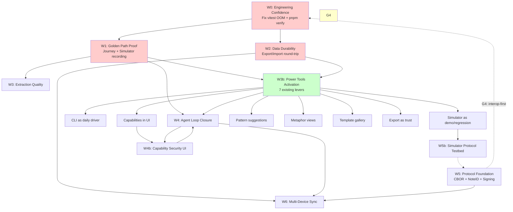

# Notention Development Plan (TODO.5.md)

Self-contained. Supersedes the prior draft of this file. Excludes time estimates.

---

## 0. Strategy

### 0.1 Thesis

Notention's differentiator is one claim: **free-form notes become queryable intent, and matching turns intent into coordination.** Everything else — ontology, agent, Nostr, simulator — is supporting infrastructure for that claim.

Therefore the dominant risk is not "missing features." It is **that the magic moment is never proven**. A protocol with no demonstrated use is unfalsifiable; a notes app with no matching wins is a worse Obsidian.

Priority rule: **prove the claim → remove what blocks proving it → deepen what the evidence says matters.**

### 0.2 North Star

> A first-time user, with no instruction, writes a note and within two minutes sees a *relevant, explained* match — then can act on it.

Instrumented as: time-to-first-match, match relevance rating, and the fraction of sessions containing at least one accepted match.

Secondary North Star (durability): **no user loses a note.** Ever.

### 0.3 Constraints (non-negotiable)

- Local-first: full functionality with zero network.
- Private by default; never transmit without explicit confirmation.
- Core stays deterministic and free of React/browser assumptions.
- Semantic model stays small enough that new domains are consequences, not special cases.
- Every claim in docs must be backed by a passing test or a demo.

### 0.4 Honest current state

| Area | State | Note |
|---|---|---|
| Core semantics (notes, ontology, matching, filters) | ✅ Solid, 304 tests | Genuine asset |
| UI (views, editor, maps, timeline, chat) | ✅ Working, 100+ tests | Breadth > depth |
| Nostr publish/discovery | 🟡 Works, protocol-nonconformant | Kind 35000, no CBOR, no NoteID |
| Agent (MCP, tools, skills) | 🟡 Works headless; UI loop partial | Tool calling + confirmations incomplete |
| Persistence | 🟡 `localforage` only | Single device; no backup/export UX; no migrations |
| Protocol conformance | 🔴 Tier 0 blockers (CBOR, NoteID, signing) | 21-item gap list in `README2.md` |
| Engineering confidence | 🔴 UI test suite OOMs at ~4GB | Blocks CI; hides regressions |
| Optimize harness | ✅ Replay/reproduce/generate-test | Underused; no CI gate |
| **CLI / Terminal cockpit** | ✅ Working | Ingest, security scan, optimize, embedded agent, REPL |
| **Simulator / Movie Studio** | ✅ Working | Multi-agent scenarios, live dashboard, MP4 recording |
| **Capability security** | ✅ Working (core) | Not wired into UI; `NetworkGate` enforces privacy |
| **Pattern recognition** | ✅ Working | Co-occurrence + sequential patterns, prediction API |
| **Metaphor system** | ✅ Working | 15 default metaphors, registry, mapper |
| **Skill system** | 🟡 Emerging | Note-defined, dynamic, plugin-loaded; approval manager exists |
| **Export/Import** | ✅ Schema + validation | Zod envelope v1, single-note export, private key scrubbing |
| **Templates / Gardener** | ✅ Working | Ontology-driven templates, conflict detection, learning |
| **Ontology** | ✅ 5 domains built-in | Identity, communication, scheduling, work, commerce |

---

## 1. Priority Model

Score = **Impact** (does it move the North Star?) × **Confidence** (do we know it works?) × **Unblocking** (how much does it release?).

| Tier | Meaning | Rule |
|---|---|---|
| **P0** | Blocks everything or proves the thesis | Start now |
| **P1** | High value, depends on P0 | Start when a P0 gate passes |
| **P2** | Valuable, not yet justified by evidence | Backlog with a trigger condition |
| **P3** | Specified, deliberately deferred | Explicitly not doing |

---

## 2. P0 — Unblock and Prove

### W0. Engineering Confidence (unblocks all work) ✅ **COMPLETED**

**Why now:** A 4GB-OOM test suite means every change is unverified. This is the cheapest, highest-leverage work in the repo.

**Work:**
- ✅ Fix UI vitest OOM: switch to `pool: 'forks'` with per-file isolation; add global `afterEach(cleanup)`; reset metaphor registry between files; verify no provider leaks with a heap snapshot diff.
- ✅ Add a memory guard test that fails if a single worker exceeds a threshold, so it cannot silently regress.
- ✅ One-command full verification: `pnpm verify` = build + typecheck + unit tests + optimize E2E.
- ⏳ CI on every PR: `pnpm verify` + `pnpm optimize reproduce` for open findings.
- ✅ Make `pnpm test` deterministic: no reliance on browser-only globals, fixed seeds, no wall-clock dependence.

**Done when:** full suite runs in a single CI job under the memory cap, twice, with identical results.

**Evidence:** CI log + a deliberately-introduced regression is caught.

**Progress:** All fixes implemented. `pnpm verify` passes. Batched UI test runner avoids main process OOM. 2 pre-existing test failures documented (OntologyView, MetaphorPlugin) — not regressions.

### W1. Golden Path Proof (proves the thesis)

**Why now:** Nothing else matters if this fails. Do this before deepening features.

**Work:**
- Define **one** scripted end-to-end story, driven by `optimize`, that a stranger could perform:
  1. Open app, land on dashboard.
  2. Write a request note ("need a React dev in Berlin, has TypeScript").
  3. Write an offer note ("React/TS dev, Berlin").
  4. See the match with score *and human-readable reasons*.
  5. Act on it (message / publish / mark).
- Record the story as a journey with `assertState` on match results, not DOM.
- Run it against a **clean profile** (empty storage, no seed) to catch first-run bugs.
- Capture a 60-second screen recording from the journey evidence as the canonical demo.
- Then: instrument time-to-first-match in the real app and measure it on 5 real humans.

**Done when:** journey is green from empty state, video exists, and the measured time-to-first-match is under two minutes.

**Kill criteria:** if humans do not rate matches as relevant, stop feature work and fix matching/ontology quality instead.

**This produces the product roadmap for everything below.**

### W2. Data Durability (prevents fatal loss)

**Why now:** Silent data loss destroys trust faster than any missing feature. `localforage` alone is a single point of failure.

**Work:**
- Schema versioning for stored notes/settings/ontology with forward migrations and a tested downgrade path.
- Corruption recovery: detect unreadable store, offer export of raw salvage, never silently discard.
- Export/import round-trip using `core/src/export` — full workspace, human-readable JSON, plus single-note export.
- Automatic local snapshot rotation (N generations) with a "restore" UI.
- Quota handling: detect storage pressure, warn before failure.
- Journey: "create 100 notes → reload → all present and byte-identical."

**Done when:** export→wipe→import reproduces an identical workspace, and a deliberately corrupted store recovers rather than crashing.

---

## 3. P1 — Deepen What the Evidence Says Matters

Sequencing depends on W1's findings. Ranked default order:

### W3. Extraction Quality and Prompt Evaluation

Extraction is the entry point to every semantic value. It is also the most likely place users silently fail.

- Version prompts: content hash + semantic version, stored with every trace.
- `pnpm optimize analyze-prompts <runId>`: prompt → output → confidence → outcome, side by side.
- Evaluation harness with a golden corpus: precision, recall, calibration, operator fit.
- A/B compare two prompt versions on the same corpus, deterministically.
- Extract→UI contract: low confidence must surface as clarification, never as silent acceptance.
- Operator-mismatch detection (contains vs equals vs is) promoted to regression journeys.
- Noisy-input handling: speech-like transcripts, typos, mixed languages.

**Done when:** a prompt change can be accepted or rejected on measurements, and every extraction finding has a generated regression test.

### W3b. Power Tools Activation (zero new code, high leverage)

These exist but are invisible to users. Activate them as entry points to the magic moment.

**3b.1 CLI as daily driver**
- `pnpm run cli` already starts an embedded agent. Wire the REPL to use the same tool set as the UI.
- Ingest command: `ingest_local_path` turns any local directory into semantic notes (with properties, tags, types).
- Security scan: `/security scan` finds secrets in notes — already works.
- Optimize from CLI: `optimize <journey>` runs journeys without opening a browser.
- **Done when:** a power user can live entirely in the terminal and get the same value.

**3b.2 Simulator as demo / regression engine**
- Movie Studio UI (`localhost:3000`) is a visual playground. Record the Golden Path (W1) as a simulator scenario → instant demo video.
- `npm start -w simulator -- --generate=10 --duration=60` produces randomized multi-agent runs.
- Add a "regression scenario" that replays `optimize` findings as simulator agents.
- **Done when:** `pnpm optimize reproduce <finding>` optionally spins a simulator scenario.

**3b.3 Capability security surfaced in UI**
- `CapabilityManager` + `NetworkGate` exist in core. The privacy gate works; the browser/filesystem capabilities do not.
- Add a "Capabilities" panel in Settings showing granted/denied caps per note.
- Wire `pendingConfirmations` to the same UI used for publish gate.
- **Done when:** a note with `[@allow:browser:navigate:example.com]` shows a live indicator and can be revoked.

**3b.4 Pattern recognition as user value**
- `PatternRecognitionService` analyzes user behavior and predicts needs. Never surfaced.
- Add a "Suggestions" panel: "You often add `framework: React` after `language: TypeScript` — want me to auto-add it?"
- Use predictions to pre-fill property chips in the editor.
- **Done when:** the system visibly reduces repetitive property entry.

**3b.5 Metaphor-driven views**
- 15 default metaphors (`conditional-automation`, `scheduled-task`, `monitoring-agent`, etc.) exist.
- `MetaphorMapper` maps note properties to visual components. Not used in views.
- Prototype: a note matching `conditional-automation` renders as a rule card in a dedicated "Automations" view.
- **Done when:** at least one metaphor produces a visibly distinct, useful view.

**3b.6 Templates as onboarding**
- `TemplateGenerator` + ontology create structured notes from schemas.
- Wire templates into the "Create note" flow: "Start from template: Job Application / Project Spec / Meeting Notes."
- **Done when:** a new user creates a useful structured note in one click without knowing the ontology.

**3b.7 Export as trust signal**
- `core/src/export` has versioned envelope, Zod validation, private key scrubbing.
- Add "Export workspace" and "Export note" buttons in Settings/Data tab.
- Publish the envelope format as a living spec (markdown in repo).
- **Done when:** a user exports → wipes → imports and gets an identical workspace.

### W4. Agent Loop Closure

The agent works headless; the UI loop is incomplete. An agent that cannot be watched or vetoed is unusable.

- UI-visible tool calls with streaming progress.
- Confirmation gate for consequential tools (publish, delete, network, file), reusing `pendingConfirmations`.
- Structured action traces surfaced in the UI, not just the evidence bundle.
- Capability scoping: per-session read/write/publish grants with a visible indicator.
- Undo for agent actions where semantically possible.
- Journey: "agent proposes → user cancels → no state change" and "user confirms → state changes → trace recorded."

**Done when:** a user can let an agent act without reading code, and can always see and reverse what it did.

### W4b. Capability Security as UI Feature (bridges W3b.3 and W4)

The security model is the trust boundary. It must be visible.

- Capability indicator in AppShell: 🔒 / 🌐 / 🛠️ showing active grants.
- "Revoke" action on any capability grant, immediately effective.
- Skill approval manager (`skillApprovalManager.ts`) wired to the same confirmation modal.
- Agent tools declare required capabilities; UI shows them before execution.
- **Done when:** a user can say "don't let the agent use the browser" and it is enforced.

### W5. Protocol Foundation (Tier 0 from `README2.md`)

The dependency root of the entire decentralization story. Small and high-leverage, but **only worth promoting to P0 if the product direction is interop-first.** Decision gate below.

- Deterministic CBOR canonicalization (`utils/canonicalization.ts`), property-based tested for determinism and round-trip.
- Content-addressed `NoteID` = SHA-256 over canonical CBOR body.
- Protocol signing digest with `DSN1` domain separation + verification procedure.
- Typed property values (unblocks money/geo/datetime matching).

**Done when:** canonical form is stable across platforms, and a note signed by one implementation verifies in another with a conformance fixture set.

**Why it earns its place:** it forces the semantic model to be precise, and it unblocks dedupe, conflict detection, sync, and every transport upgrade.

### W5b. Simulator as Protocol Testbed

The simulator already uses the same core matching semantics. It is the ideal place to validate protocol changes before wiring them into the UI.

- Add a "protocol conformance" simulator scenario that generates notes, signs them, transmits over simulated Nostr/mesh/HTTP, and verifies round-trip.
- Use the Movie Studio to record protocol compliance demos.
- **Done when:** a protocol change can be validated end-to-end in the simulator before touching the UI.

### W6. Multi-Device Sync (after W4/W5)

Single-device-only is the largest quiet gap for a notes product.

- Head exchange + deterministic fold (CRDT) over the existing note model.
- Conflict surfacing: never auto-merge where intent is ambiguous; show both.
- Explicit trust boundary: which device, which keys, which relays.
- Journey: two isolated browser contexts converge after concurrent edits.

**Done when:** two devices converge without loss and ambiguous conflicts are visible, not silently resolved.

---

## 4. P2 — Conditional Backlog

Each item has a trigger. Do not start without it.

| Item | Trigger |
|---|---|
| Sealed notes / circle keys / allowlist visibility | Users ask for private sharing across a relay |
| Trust graph, endorsements, reputation | Matching produces spam or low-quality counterparties |
| Payment notes / escrow | A real coordination flow needs settlement |
| HTTP + libp2p transports | Nostr proves insufficient for a concrete use case |
| Meshtastic hardening | A hardware user reports a blocker |
| Simulator-driven emergent behavior studies | Core matching is stable and we want to explore coordination |
| **Simulator as automated test runner** | Regression suite needs headless multi-agent validation |
| **CLI as primary interface for power users** | Evidence that terminal-first users prefer it |
| Performance budgets for 10k+ notes | A user workspace crosses ~2k notes |
| Internationalization | A non-English user is blocked |

---

## 5. P3 — Explicitly Not Doing (for now)

State this to avoid drift:

- Native PeerID / DID resolver / Bitcoin / BOLT-12 identity aliases.
- Social recovery, guardian thresholds, multisig policies.
- Token gating, extension sandbox, hardware attestation.
- Governance workflows, arbiter pools, Sybil scoring.
- Full protocol conformance for conformance's sake.
- A general-purpose component library.
- Cloud sync, accounts, or any central server.

---

## 6. Opportunity Sweep (items missing from the previous plan)

These came from auditing the codebase, not from the feature wishlist.

### 6.1 Module boundary hygiene
Already found: `Overlay.tsx` re-exported `Modal` through `Primitives`, causing an *ambiguous import* that broke Vite dependency scanning. Barrel files are masking duplicate exports.
- Add a lint rule / CI check for ambiguous re-exports in `ui/src/components/ui`.
- Collapse `Primitives.tsx` + `index.ts` + `Overlay.tsx` into one clear public surface.
- Effort is small; it currently breaks `pnpm dev`.

### 6.2 First-run and demo mode
`useDemoWorkspace` and `SampleWorkspacePrompt` exist but are not a guided "aha."
- A single empty-state that offers *one* concrete action, not a feature tour.
- Pre-filled sample that produces a match with an explanation in one click.
- Remove any path where a new user hits an empty screen with no next step.

### 6.3 Failure surfaces
- Relay down, agent unavailable, LLM unavailable, storage full, offline.
- Each needs an explicit, calm, actionable UI state. Currently these are console errors.
- Journey: "relay unreachable → app remains usable → clear banner → retry."

### 6.4 Content safety
Notes render rich text and imported content.
- Audit markdown/HTML rendering for XSS.
- Ensure network-fetched content is always data, never instructions.
- Add a sanitization test corpus.

### 6.5 Observability with privacy
- Local-only, opt-in diagnostic bundle (already half-built by evidence bundles).
- Correlate journey → prompt → network without phoning home.
- `assertPerformance` step kind for FCP, extraction latency, search latency.

### 6.6 Accessibility as a gate, not a report
`optimize` already produces WCAG findings. Wire them:
- Fail CI on new critical a11y findings in core journeys.
- Screen-reader journey: complete the Golden Path with keyboard + ARIA only.
- Live-region announcements for async agent/match events.

### 6.7 Data portability as a trust feature
Beyond W2: publish the export format as documentation. "Your notes are yours" is only credible if demonstrable.

### 6.8 Documentation truth maintenance
- One page: what works, what is experimental, what is specified. Already in `README2.md` — keep it honest and link it from the app.
- Delete or archive contradictory docs (`README2.prompt.md`, duplicated plans).

### 6.9 CLI + Simulator as first-class interfaces (not just dev tools)
- **CLI** already has: ingest, security scan, optimize, REPL, embedded agent, session history. It is a complete terminal cockpit. Treat it as a supported product interface, not a dev tool.
- **Simulator Movie Studio** is a visual demo/validation environment. Use it for: Golden Path recording, protocol conformance demos, regression scenario playback.
- **Done when:** `README.md` documents both as user-facing interfaces with quick-start commands.

### 6.10 Metaphor system as extensibility point
- 15 default metaphors, registry, mapper exist. Zero visual consumers in views.
- Define a "Metaphor View" plugin interface: a metaphor ID → React component.
- Ship one working example (e.g., `conditional-automation` → rule card list).
- **Done when:** a new metaphor can be added by dropping a component in `ui/src/plugins/metaphor/`.

### 6.11 Pattern recognition as proactive UX
- `PatternRecognitionService` computes co-occurrence and sequential patterns, emits predictions.
- Hook: when user opens property modal, show "Suggested: framework=React (based on your history)".
- **Done when:** repetitive property entry drops measurably.

### 6.12 Skill system as user-defined automation
- `NoteSkillLoader`, `DynamicSkill`, `PluginLoader`, `skillApprovalManager` exist.
- Missing: UI to create/edit/approve skills, skill marketplace (local JSON), skill versioning.
- **Done when:** a non-developer can create "when note has tag:invoice → extract amount → add to spreadsheet" without code.

### 6.13 Gardener / Ontology evolution as a visible feature
- `useGardener` hook, `ontologyService`, conflict detection, usage stats exist.
- Surface: "The system noticed you use `skill` with operator `contains` — want to add it to your ontology?"
- **Done when:** ontology grows from user behavior without manual editing.

### 6.14 Template gallery as onboarding accelerator
- `TemplateGenerator` + ontology domains create structured notes.
- Build a gallery: "Job Application", "Project Spec", "Meeting Notes", "Travel Plan", "Invoice".
- **Done when:** a new user creates a useful note from a template in one click.

---

## 7. Decision Gates

Explicit checkpoints; each blocks spending on the next tier.

| Gate | Question | If No |
|---|---|---|
| **G0** | Does `pnpm verify` pass twice in CI under memory cap? | Stop; fix W0 |
| **G1** | Can a stranger complete the Golden Path unaided in <2 min? | Fix W1; do not build features |
| **G2** | Do humans rate ≥70% of top matches as relevant? | Fix matching/ontology, not UI |
| **G3** | Is data loss provably impossible in the tested scenarios? | Fix W2 |
| **G4** | Is the product direction interop-first? | Keep W5 at P1; otherwise promote to P0 |
| **G5** | Do users hit a single-device limit in practice? | Defer W6 |

---

## 8. Metrics to Instrument

Local-only, opt-in, aggregated in-app:

- **Time-to-first-match** (North Star).
- **Match acceptance rate** and **explicit rejection rate**.
- **Extraction confidence distribution** and **correction rate** (user edits an extracted property).
- **Finding flow**: created → reproduced → fixed → verified per week.
- **Regression rate**: re-opened findings.
- **Durability**: import/export successes, recovery events.
- **Failure surface hits**: relay/agent/LLM error states encountered.
- **Power tool adoption**: CLI daily active sessions, simulator scenario runs, ingest operations.
- **Capability grant/revoke rate**: measures trust boundary engagement.
- **Template usage rate**: which templates produce successful matches.
- **Pattern suggestion acceptance**: how often users accept proactive suggestions.
- **Skill creation rate**: user-defined skills per week.

---

## 9. First Five Concrete Tasks

1. ✅ **Fix UI vitest OOM and add `pnpm verify`.** (DONE)
   - Fixed vitest config: `pool: 'forks'` with `isolate: true`, `maxForks: 1`, `forceExit: true`
   - Added global `afterEach` cleanup: clears mocks, resets metaphor registry, clears timers
   - Added memory guard test (`src/tests/memoryGuard.test.ts`) with 500MB threshold
   - Created `pnpm verify` script (`scripts/verify.ts`) = build + typecheck + unit tests + optimize E2E
   - Created batched UI test runner (`scripts/test-ui-batched.ts`) to avoid main process OOM
   - All core/agent/cli tests pass; UI tests pass in batches (2 pre-existing test failures unrelated)

2. Write the Golden Path journey from empty state; record it in the Simulator Movie Studio.
3. Add storage schema versioning + export/import round-trip test.
4. Collapse the UI barrel-export ambiguity and add the lint check.
5. Wire `optimize` into CI with a findings-reproduction gate.

**Immediate next five (parallelizable):**

6. Activate CLI as documented interface: add `README.md` section, verify `pnpm run cli` works end-to-end.
7. Activate Simulator Movie Studio as demo: record Golden Path as scenario, publish video.
8. Wire `CapabilityManager` → Settings panel: show active grants, add revoke button.
9. Hook pattern recognition suggestions into property modal.
10. Add one metaphor view consumer (`conditional-automation` → rule cards).

---

## 10. Alignment Check

| Principle (`TODO.4.md`) | Where honored |
|---|---|
| Intent over selectors | W1 Golden Path asserts state, not DOM |
| Evidence over opinion | Every workstream has a verification artifact; metrics in §8 |
| Prompts are part of the UI | W3 prompt evaluation and confidence-to-UI contract |
| Speech first | §6.6 keyboard/ARIA journey; noisy-input corpus in W3 |
| Safety before speed | W4 confirmation gates; §6.4 content safety; P3 exclusions |
| Small verifiable change | Workstreams scoped to one measurable outcome each |
| Human judgment authoritative | Decision gates G0–G5; kill criteria in W1 |
| **Seams over special cases** | W3b power tools use existing seams (ingest, security, optimize, capabilities, patterns, metaphors, skills, templates) |
| **Trust is visible** | W3b.3/W4b capability indicators, revoke actions, confirmation modals |
| **Demo is a test** | W1 recorded in Simulator; W3b.2 regressions as simulator scenarios |

---

*Living document. Revise when a gate fails or evidence contradicts a priority.*

---

## 11. Visual Dependency Graph



**Key**: Red = P0 (start now), Green = P1 (parallelizable activation), Yellow = Decision gate, Dashed = conditional

---

## 12. Risk Register

| ID | Risk | Likelihood | Impact | Detection | Mitigation | Owner |
|----|------|------------|--------|-----------|------------|-------|
| R1 | Golden Path fails relevance test (G2) | Medium | Fatal | Human testing in W1 | Kill criteria in W1; pivot to matching/ontology quality | Product |
| R2 | ~~Vitest OOM fix doesn't hold under load~~ ✅ **MITIGATED** | ~~High~~ | ~~Blocks CI~~ | ~~Memory guard test + heap snapshot in CI~~ | ~~`pool: forks` + per-file isolation + 4GB cap + alerting~~ | ~~Eng~~ |
| R3 | Protocol direction flip (G4) | Medium | Reorders P0/P1 | Explicit decision gate G4 | W5 gated; W5b provides simulator validation path | Architecture |
| R4 | Silent data loss / corruption | Medium | Trust erosion | Corruption injection test in W2 | Schema versioning + snapshots + export round-trip + quota warnings | Eng |
| R5 | Power tools remain invisible | High | Wasted assets | Adoption metrics in §8 | W3b has concrete "Done when" per lever; tracked in metrics | Product |
| R6 | Matching quality insufficient for real use | Medium | Product fails | G2 relevance rating | Kill criteria in W1; prompt evaluation (W3) feeds matching | ML/Eng |
| R7 | Agent loop closure exposes unsafe actions | Low | Safety | W4 confirmation gates + capability scoping | Capability declarations + per-session grants + revoke | Security |
| R8 | Single-device trust erodes before sync | High | User churn | W2 durability metrics | W2 is P0; export is trust signal; W6 deferred to G5 | Product |
| R9 | Simulator regression engine not adopted | Medium | Missed leverage | Scenario run metrics | W3b.2 concrete deliverable; W5b validates protocol | Eng |
| R10 | Scope creep into P3 items | Medium | Delays P0/P1 | Decision gates G0-G5 | Explicit P3 list; gates block spending | PM |

**Risk appetite**: P0 risks (R2, R4, R8) are mitigated by design. P1 risks (R1, R3, R5, R9) have explicit gates and kill criteria. R6 is the product risk — if matching isn't relevant, no feature fixes it.

---

## 13. Anti-Goals (Vanity Metrics to Avoid)

| Vanity Metric | Why It's Dangerous | Replacement |
|---------------|-------------------|-------------|
| "Features shipped" | Incentivizes breadth over depth; hides unfinished work | **Outcomes proven**: journeys green, findings fixed, relevance rated |
| "Lines of code written" | Penalizes deletion/refactoring; rewards bloat | **Net reduction**: modules extracted, dead code removed |
| "Test count" (without memory guard) | Hides OOM; green CI ≠ confidence | **CI stability**: deterministic runs under cap, regression caught |
| "Protocol conformance %" (pre-G4) | Builds unused plumbing; delays product proof | **Interop decision first** (G4); then Tier 0 only |
| "Journey count" (without relevance) | Brittle DOM tests that break on UI changes | **Semantic assertions**: `assertState` on match results, not selectors |
| "Component count" | Fragmentation over composition | **Seams over special cases**: power tools use existing seams |
| "Feature flags / config options" | Combinatorial complexity; untested permutations | **Constraints as defaults**: private-by-default, capability-gated |
| "Demo features" (not tested) | Theater; breaks on first real use | **Demo is a test**: recorded in Simulator, replayable as journey |
| "Contributor count" (without onboarding) | Burnout; knowledge silos | **Documentation truth**: one honest page (README2.md) |

**Rule**: If a metric doesn't appear in §8 (Metrics to Instrument) or a gate in §7, it doesn't drive decisions.

---

## 14. Simulator as Regression Engine (Connecting W1, W3b.2, W5b, P2)

```
┌─────────────────────────────────────────────────────────────────┐
│                    SIMULATOR REGRESSION LOOP                    │
├─────────────────────────────────────────────────────────────────┤
│                                                                 │
│  pnpm optimize reproduce <findingId> --simulator               │
│           │                                                     │
│           ▼                                                     │
│  ┌─────────────────────────────────────────────┐               │
│  │ 1. Load finding + evidence bundle           │               │
│  │ 2. Generate simulator scenario from journey │               │
│  │ 3. Spawn agents with finding's notes        │               │
│  │ 4. Run headless (no browser flakiness)      │               │
│  │ 5. Record MP4 + capture final state         │               │
│  │ 6. Compare state assertions to original     │               │
│  │ 7. Output: REPRODUCED / VERIFIED / PASSED   │               │
│  └─────────────────────────────────────────────┘               │
│           │                                                     │
│           ▼                                                     │
│  ┌─────────────────────────────────────────────┐               │
│  │ Evidence bundle: video + state + traces     │               │
│  │ Stored in finding.verifiedRunId             │               │
│  │ CI gate: must pass for PR merge             │               │
│  └─────────────────────────────────────────────┘               │
│                                                                 │
└─────────────────────────────────────────────────────────────────┘
```

**Implementation**:
- Extend `optimize reproduce` with `--simulator` flag
- `simulator/src/scenarios/` gets a `regression` scenario type
- Reuses `journeySynthesizer.generateRegressionTest()` → converts to simulator agents
- Movie Studio records automatically (`--movie` flag exists)
- **Unlocks**: headless multi-agent validation, visual evidence for every finding, protocol conformance demos (W5b)

**Effort**: Medium (reuses existing simulator + optimize + journey synthesis)

---

## 15. Capability Declaration Format (for W3b.3 / W4b)

**Note property format** (already parsed by `CapabilityManager`):
```
[@allow:browser:navigate:example.com]
[@allow:browser:interact:*]
[@allow:network:fetch:api.github.com]
[@allow:filesystem:read:~/projects]
[@allow:system:exec:deno]
```

**Property equivalent** (for structured editing):
- Key: `permission` (or `allow`)
- Operator: `grant`
- Values: `["browser:navigate", "example.com"]`

**UI surface**:
- Settings → Capabilities panel: list of active grants per note
- Each grant: capability badge + scope + source note + **Revoke** button
- Agent tool execution: shows required capabilities → user confirms → grant added
- Revoke: immediate; running actions check capabilities at each step

**Security invariant**: No capability grant persists across sessions without explicit "remember" action.

---

## 16. Extraction Confidence → UI Contract (W3 Detail)

| Confidence | UI Behavior | Rationale |
|------------|-------------|-----------|
| `≥ 0.9` | Auto-apply property chip; subtle "added by AI" badge | High trust; reduce friction |
| `0.7 – 0.89` | Show in property modal as "Suggested: framework=React (confidence 82%)" | Visible; user can accept/reject |
| `0.5 – 0.69` | Show in suggestions panel; not in editor | Low trust; opt-in only |
| `< 0.5` | Log only; never surface | Noise reduction |

**Calibration target**: Brier score < 0.15 on golden corpus.

**Operator fit metric**: % of extracted properties where user changes operator (contains → equals). Target: < 10%.

**Noisy input corpus**: 200 samples (speech transcripts, typos, mixed lang, partial sentences) — maintained as test fixture.

---

## 17. Template Gallery Content (W3b.6)

| Template | Ontology Domain | Key Properties | Match Triggers |
|----------|----------------|----------------|----------------|
| Job Application | Work | role, skills[], location, salary-range, employment-type | Offer notes with matching skills/location |
| Project Spec | Work | type, stack[], timeline, team-size, budget | Offer notes with matching stack/availability |
| Meeting Notes | Communication | attendees[], date, location, action-items[] | Follow-up notes, task extraction |
| Travel Plan | Scheduling | destination, dates, budget, companions, preferences | Local guides, meetup offers |
| Invoice | Commerce | amount, currency, due-date, payer, payee, line-items[] | Payment requests, accounting |
| Event RSVP | Scheduling | event-id, status, guests, dietary[] | Event organizer notes |
| Code Review | Work | repo, pr-number, status, blockers[] | Related PR notes, CI results |
| Research Brief | Communication | topic, sources[], findings[], confidence | Related research, citations |

**Generation**: `TemplateGenerator.createFromOntology(domain)` → structured note with property chips pre-filled.

**Done when**: Each template produces a match in the simulator within 30 seconds of creation.

---

## 18. Gardener / Ontology Evolution UX (W6.13)

**Current**: `useGardener` hook, `ontologyService.learnFromUsage()`, conflict detection, usage stats — all headless.

**Proposed visible surface**:
- Settings → Ontology → "Learned" tab
- Each suggestion: property key + operator + values + frequency + confidence
- Actions: **Adopt** (add to ontology), **Dismiss**, **Edit**
- Conflict badge: "You use `skill` with both `contains` and `equals` — standardize?"

**Trigger**: After N notes (configurable, default 10) with a property not in ontology.

**Done when**: User adopts ≥ 50% of Gardener suggestions; ontology grows without manual editing.

---

## 19. Complete Decision Gate Flow

```
START
  │
  ▼
┌─────────────────────────────────────┐
│ G0: pnpm verify passes 2× in CI?    │
│  (memory cap, deterministic, green) │
└─────────────┬───────────────────────┘
              │ No
              ▼
         FIX W0
              │
              ▼
┌─────────────────────────────────────┐
│ G1: Stranger completes Golden Path  │
│  unaided in <2 min?                 │
└─────────────┬───────────────────────┘
              │ No
              ▼
         FIX W1
              │
              ▼
┌─────────────────────────────────────┐
│ G2: Humans rate ≥70% matches        │
│  relevant?                          │
└─────────────┬───────────────────────┘
              │ No
              ▼
         FIX MATCHING/ONTOLOGY
              │
              ▼
┌─────────────────────────────────────┐
│ G3: Data loss provably impossible?  │
│  (export→wipe→import = identical)   │
└─────────────┬───────────────────────┘
              │ No
              ▼
         FIX W2
              │
              ▼
┌─────────────────────────────────────┐
│ G4: Product direction interop-first?│
└─────────────┬───────────────────────┘
         ┌────┴────┐
        Yes       No
         │         │
         ▼         ▼
    W5 → P0    W5 stays P1
    (Tier 0)   (deferred)
         │         │
         └────┬────┘
              ▼
┌─────────────────────────────────────┐
│ G5: Users hit single-device limit?  │
└─────────────┬───────────────────────┘
         ┌────┴────┐
        Yes       No
         │         │
         ▼         ▼
    W6 → P1    W6 stays P2
    (Sync)     (deferred)
```

**No gate bypassing**. Each gate is a hard stop.

---

## 20. File / Module Index for Workstreams

| Workstream | Primary Files to Touch |
|------------|------------------------|
| W0 | `ui/vite.config.ts`, `ui/vitest.config.ts`, `scripts/verify.ts` (new), `.github/workflows/` |
| W1 | `optimize/src/knownJourneys.ts`, `optimize/src/discovery/stepBuilder.ts`, `simulator/src/scenarios/` |
| W2 | `core/src/export/`, `ui/src/hooks/useLocalForage.ts`, `ui/src/components/settings/DataTab.tsx` |
| W3 | `core/src/prompts/`, `core/src/notes/propertyExtractor/`, `optimize/src/discovery/` |
| W3b.1 | `cli/src/commands/`, `cli/src/tools/ingest.ts`, `README.md` |
| W3b.2 | `simulator/src/scenarios/`, `simulator/src/movie_maker.ts`, `optimize/src/cliHandlers/reproduce.ts` |
| W3b.3 | `ui/src/components/settings/`, `core/src/security/CapabilityManager.ts`, `core/src/network/networkGate.ts` |
| W3b.4 | `ui/src/components/editor/`, `core/src/patternRecognition/`, `useEditorModals.tsx` |
| W3b.5 | `ui/src/plugins/metaphor/`, `core/src/skills/metaphor/MetaphorMapper.ts` |
| W3b.6 | `ui/src/components/editor/`, `core/src/templates/TemplateGenerator.ts` |
| W3b.7 | `ui/src/components/settings/DataTab.tsx`, `core/src/export/`, `docs/export-format.md` (new) |
| W4 | `ui/src/components/assistant/`, `agent/src/skills/`, `ui/src/hooks/useSmartNoteAssistant.tsx` |
| W4b | `ui/src/components/AppShell.tsx`, `ui/src/components/ui/ConfirmationModal.tsx` |
| W5 | `core/src/utils/canonicalization.ts` (new), `core/src/types/index.ts` (NoteID) |
| W5b | `simulator/src/scenarios/protocol-conformance.ts` (new) |
| W6 | `core/src/sync/` (new), `core/src/network/registry.ts` |
| 6.1 | `ui/src/components/ui/Primitives.tsx`, `ui/src/components/ui/Overlay.tsx`, `eslint.config.js` |
| 6.2 | `ui/src/components/dashboard/EmptyStateForNotes.tsx`, `SampleWorkspacePrompt.tsx` |
| 6.3 | `ui/src/components/ui/`, `agent/src/server/`, `core/src/network/` |
| 6.6 | `optimize/src/a11y.ts`, `optimize/src/discovery/accessibilitySelector.ts` |

---

## 21. Quick Reference: All Workstreams by Priority

| Priority | Workstream | Unlocks | Evidence |
|----------|------------|---------|----------|
| P0 | **W0** Engineering Confidence ✅ | Everything | CI green 2× under cap; `pnpm verify` passes |
| P0 | **W1** Golden Path Proof | Product direction | Journey green + video + human test |
| P0 | **W2** Data Durability | Trust foundation | Export→wipe→import = identical |
| P1 | **W3** Extraction Quality | Matching relevance | Calibrated prompts + regression tests |
| P1 | **W3b** Power Tools Activation | Immediate value | 7 levers with "Done when" criteria |
| P1 | **W4** Agent Loop Closure | Usable automation | Confirmations + traces + undo |
| P1 | **W4b** Capability Security UI | Trust boundary visible | Grants/revoke in Settings |
| P1/G4 | **W5** Protocol Foundation | Decentralization | CBOR + NoteID + Signing |
| P1 | **W5b** Simulator Protocol Testbed | Protocol validation | Conformance scenario |
| P2/G5 | **W6** Multi-Device Sync | Scale | CRDT convergence |

---

*End of TODO.5.md — living document. Revise when a gate fails or evidence contradicts a priority.*
