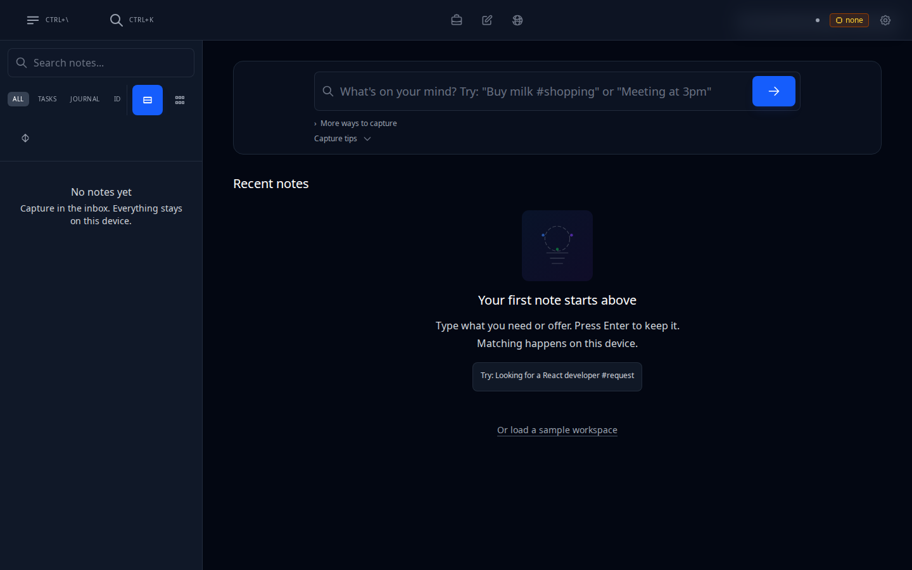
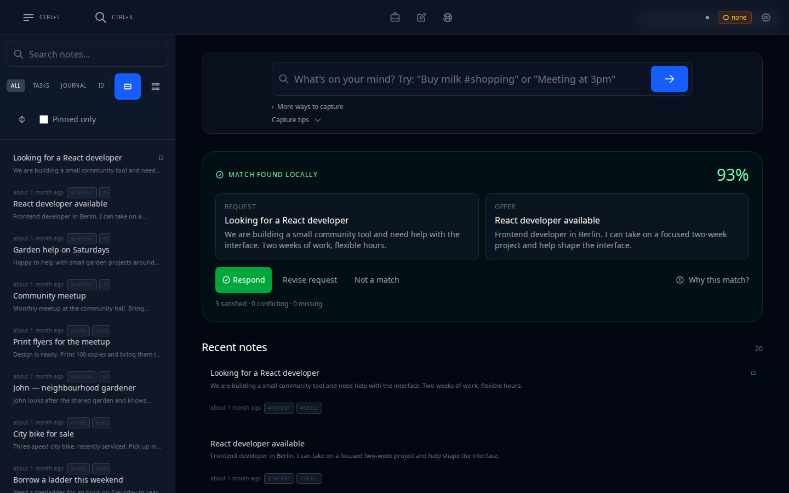
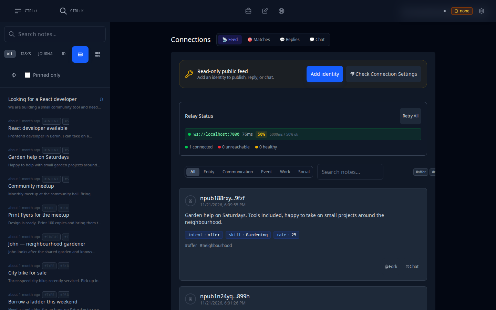
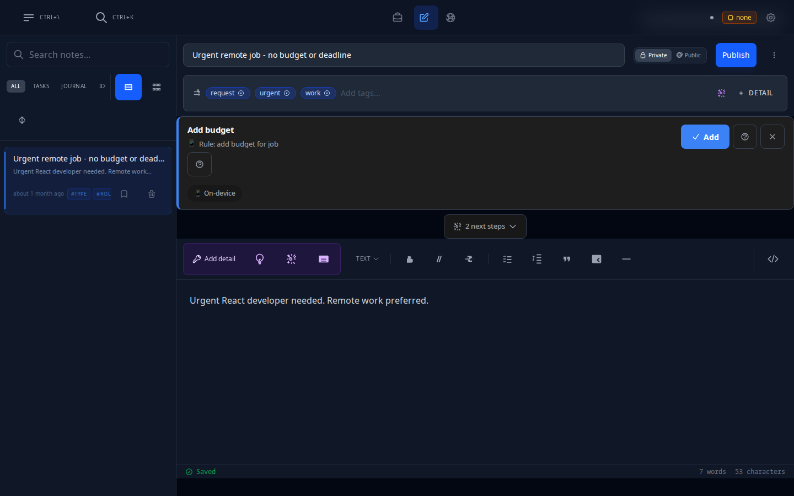
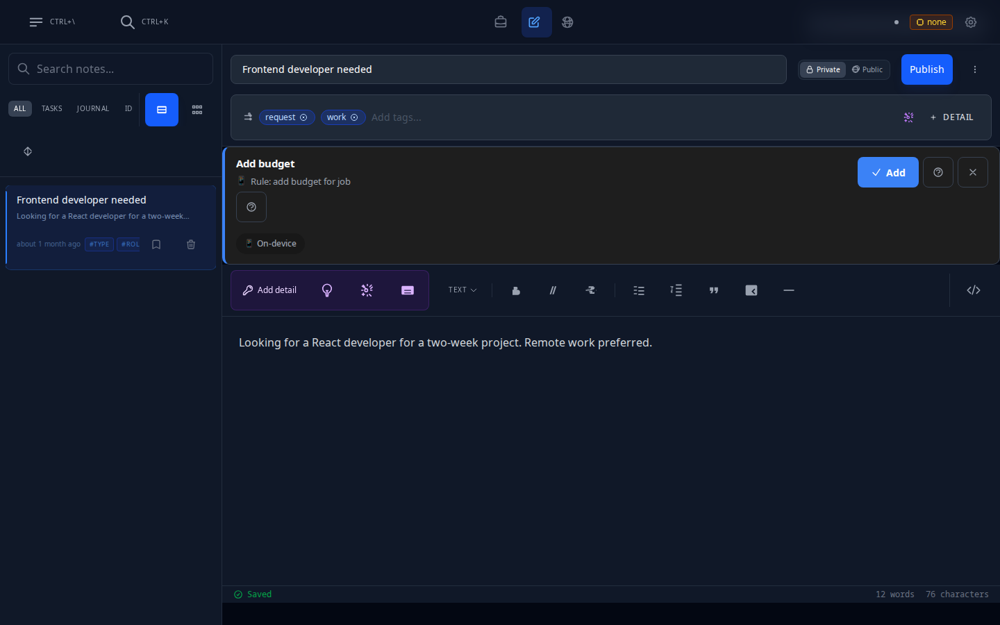
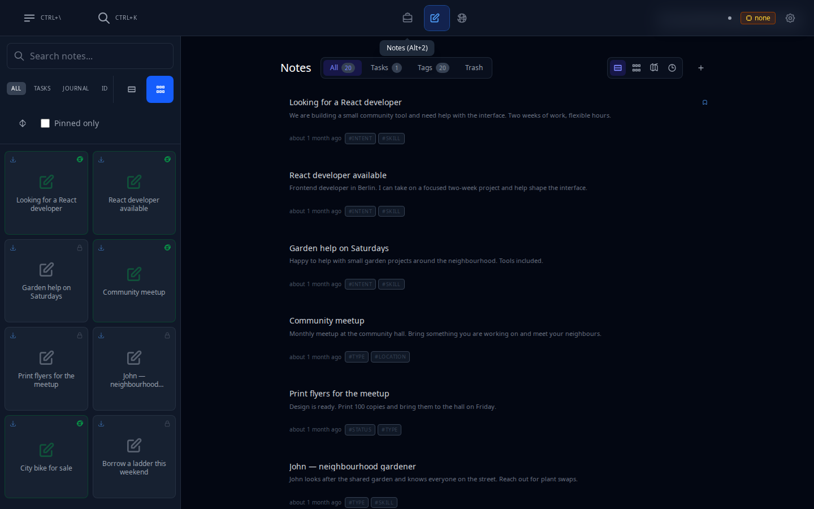
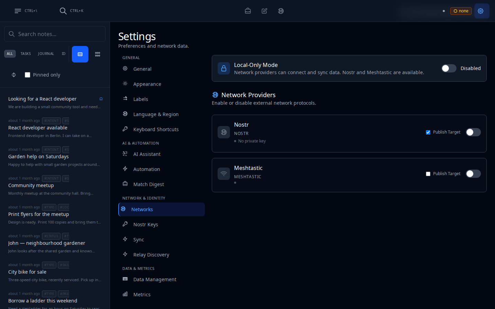

# Screenshots

Generated by `pnpm run screenshots`. These images demonstrate what the system can do; they are not test baselines.

16 images.

### inbox / empty

First run with an empty notebook and a sample-workspace affordance.

### inbox / populated

Stats, an offline match preview, recent activity, and tools.

### network / connect-identity

Network view before an identity exists, prompting setup.

### network / feed

Public feed with signed notes from a local relay, including structured details.

### next-steps / applied

After applying a next step, it shows in applied history with fit count and undo button.

### next-steps / drawer-open

Next steps drawer opens showing all steps with sections for active, applied history, and matches.

### next-steps / empty

Simple note with no matching rules shows empty next steps state with refresh button.

### next-steps / mobile

Next steps strip on mobile viewport shows single card with touch-friendly targets.

### next-steps / multiple

Note with multiple triggers shows multiple next step cards (Add budget, Add deadline, Fulfillment hint).

### next-steps / single

Job request note triggers single "Add budget" next step via deterministic rules.

### next-steps / stale

After editing a note, prior next steps become stale (showing refresh action) and new generation starts.

### next-steps / zero-match

Note with next step shows zero local/network matches in drawer.

### notes / grid

Grid mode with pinned and private notes visible at a glance.

### notes / list-selected

List mode with a note open in the editor.

### notes / trash

Trash with restore and permanent-delete affordances.

### settings / networks

Provider status and relay management.

