# Screenshots

Generated by `pnpm screenshots` (all) or `pnpm screenshot <group>` (one area). Set `SCREENSHOT_WORKERS` to change parallelism (defaults to the machine CPU count, capped at 8). These images demonstrate what the system can do; they are not test baselines.

18 images.

### capture / composer

The full-screen composer, with the same field and one primary action.

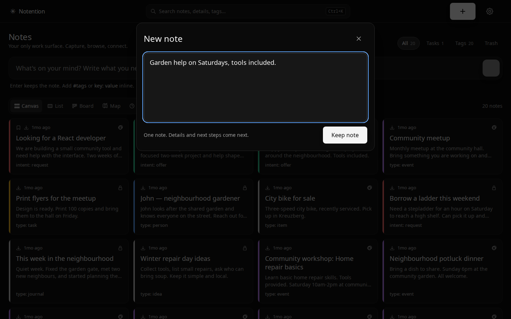

### note / chat

Encrypted chat for a note contact, in the same rail.

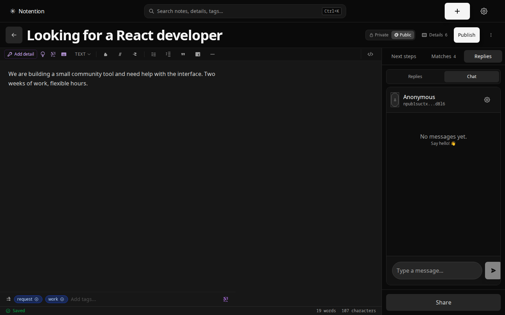

### note / context

Matches live in the note context rail.

### note / detail

The note is the page, with one primary action.

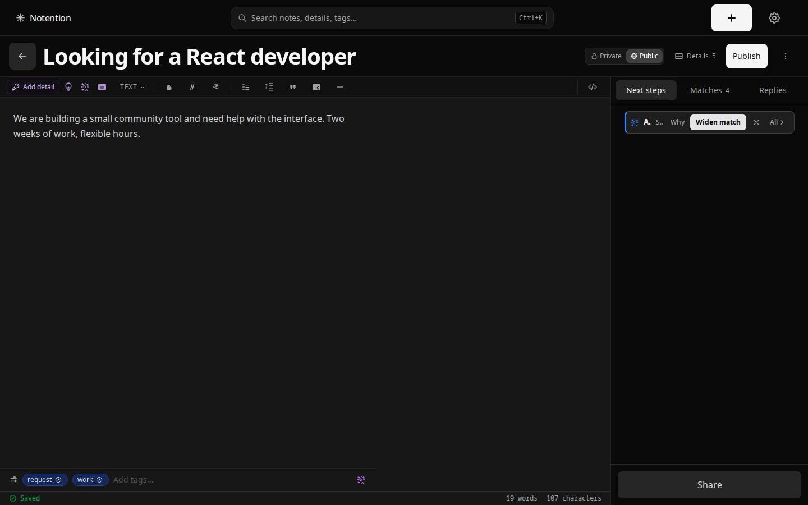

### note / replies

Replies are part of the note, with one composer.

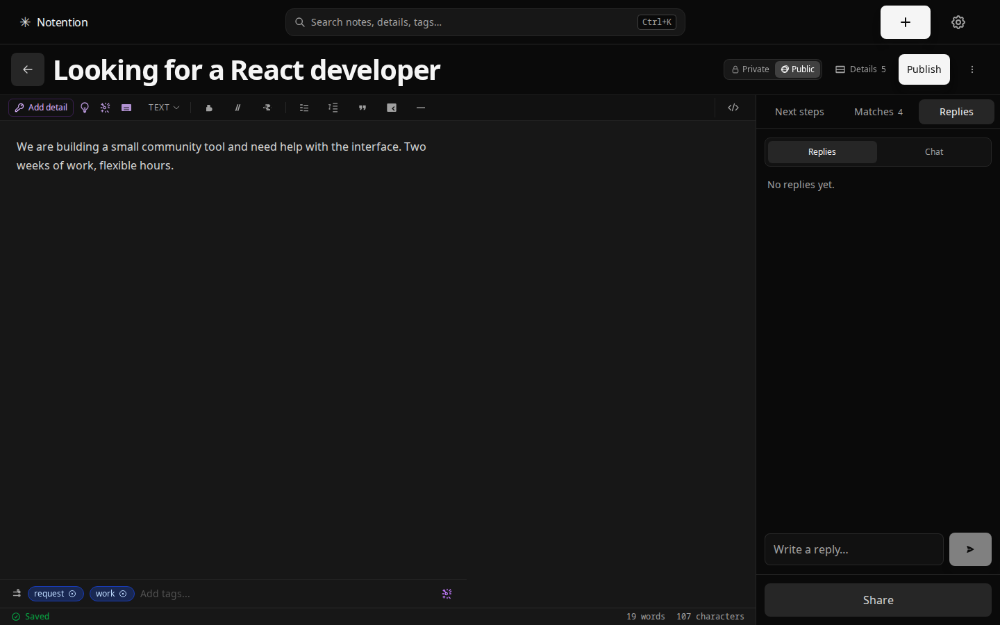

### notes / board

Tasks grouped into status columns.

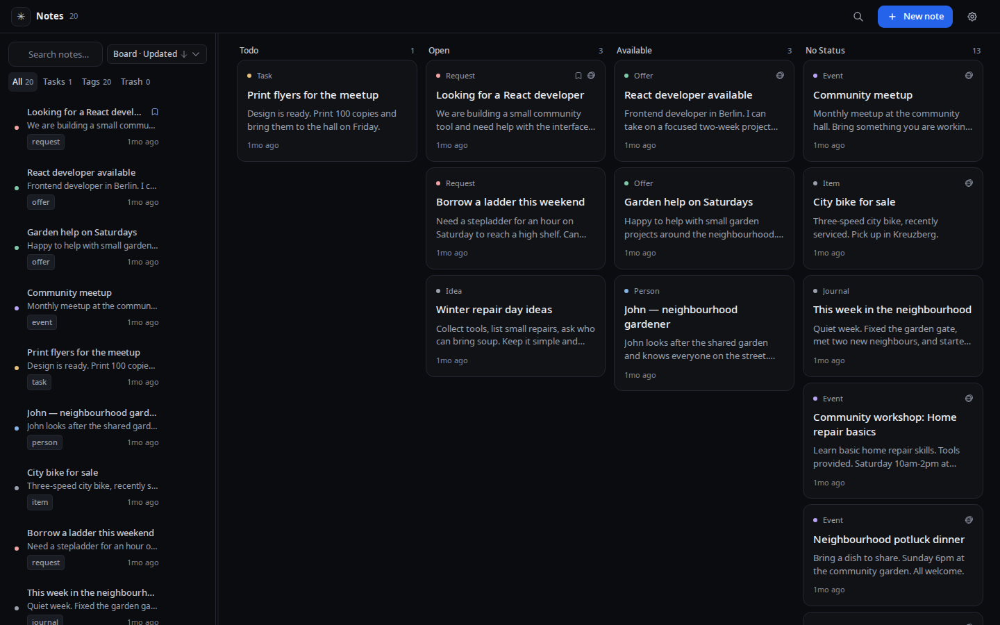

### notes / empty

First run: one omnibox and one line.

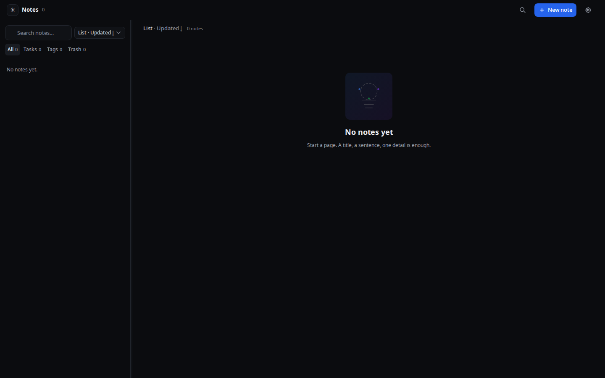

### notes / grid

Full-bleed canvas of notes at 1440px.

### notes / map

Notes with locations plotted on the map.

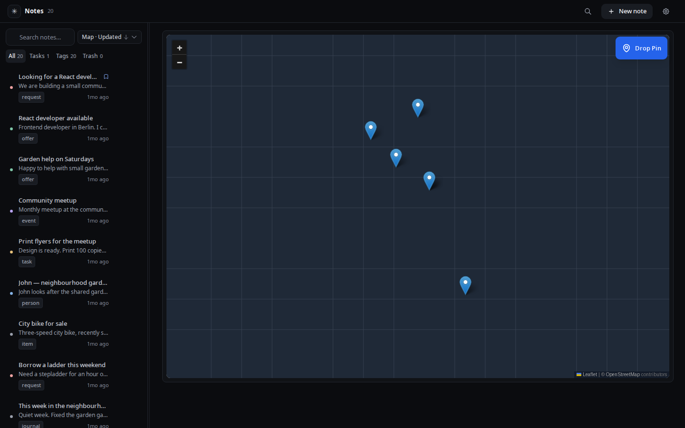

### notes / timeline

Dated notes on one timeline.

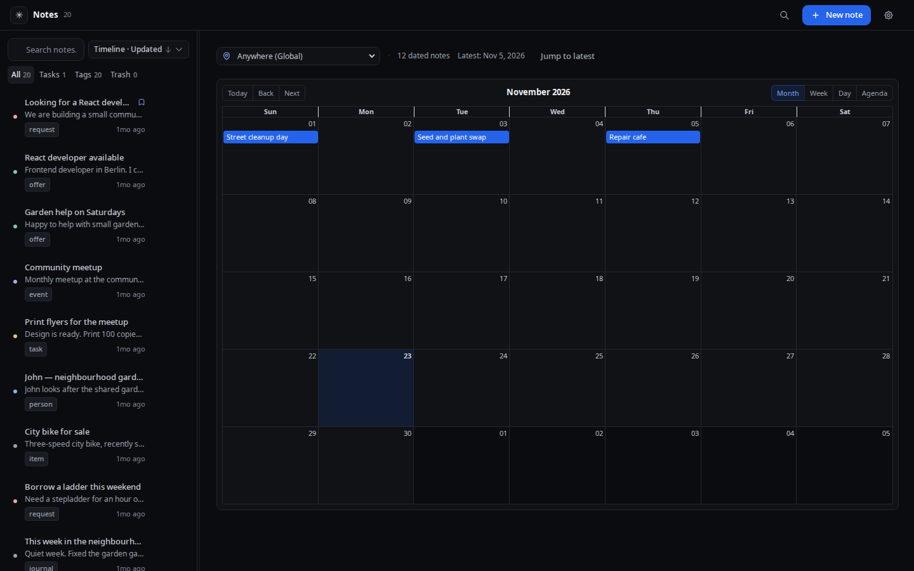

### search / explore

Public notes stay reachable from the one search overlay.

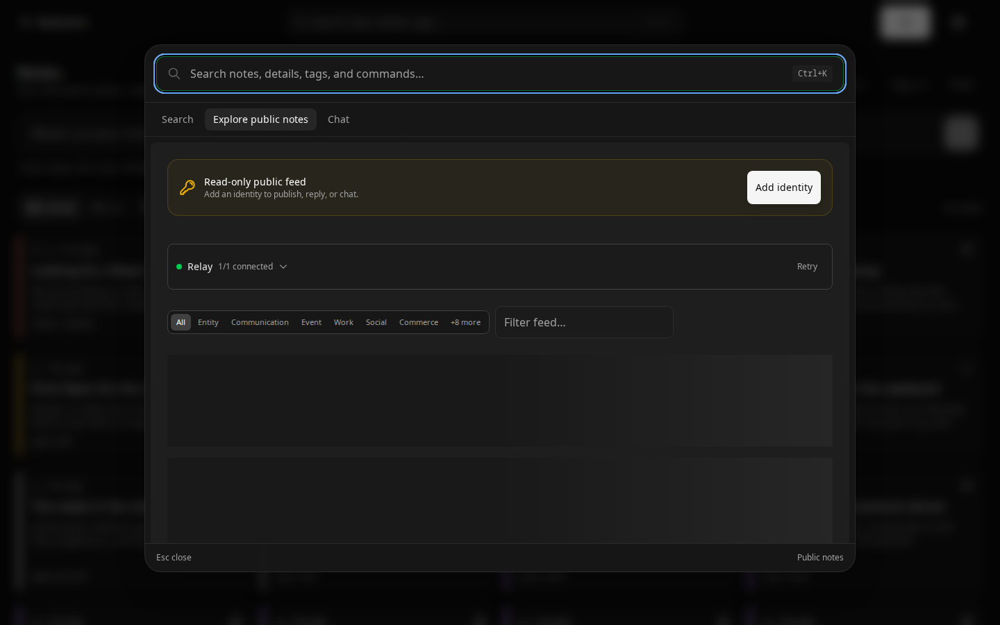

### search / overlay

One overlay for notes, details, tags, and commands.

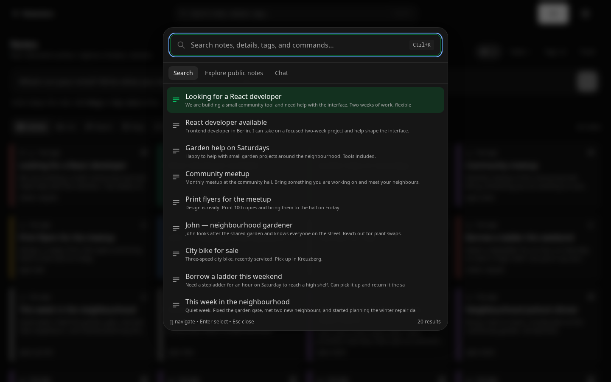

### settings / appearance

Appearance stays a settings tab, including the light theme option.

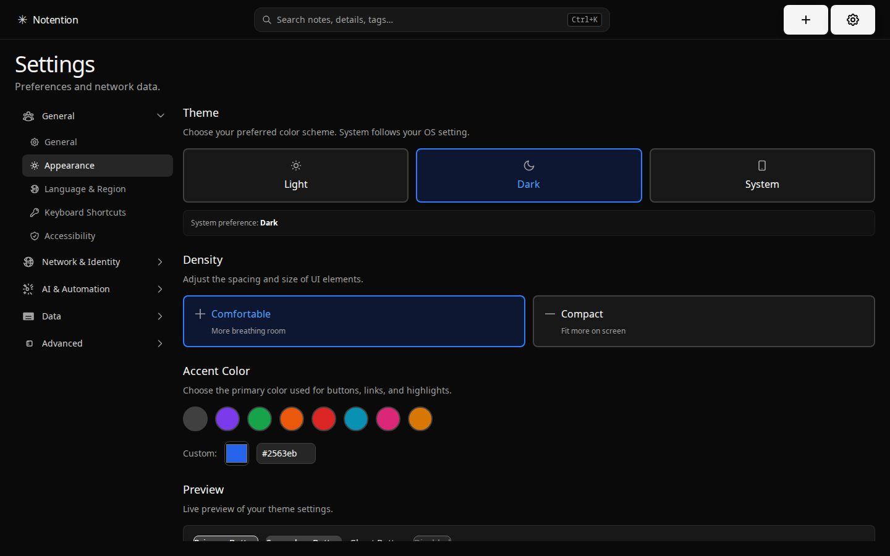

### settings / general

Five settings groups, one open at a time.

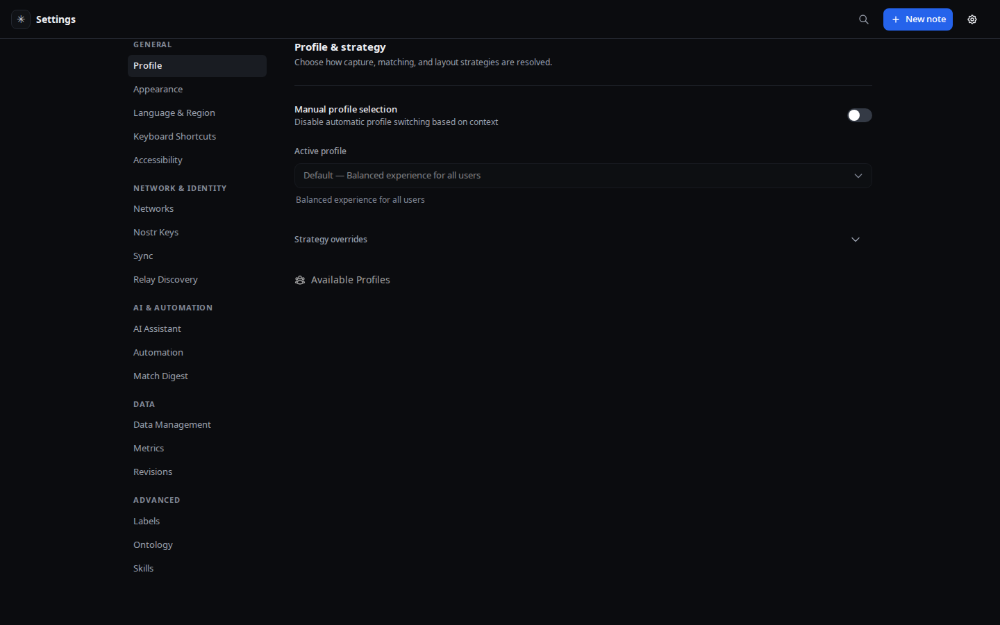

### settings / labels

Labels remain a settings tab, reachable by deep link.

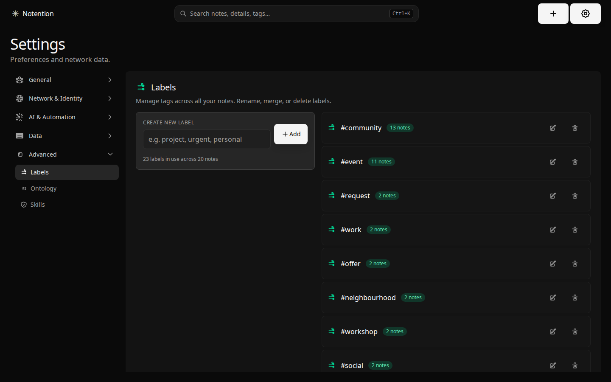

### settings / network

Network and identity live in one settings group.

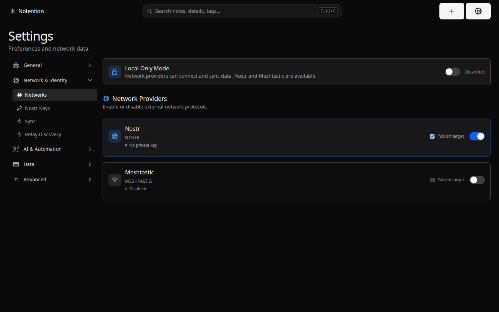

### settings / ontology

Ontology remains a settings tab, with the graph editor.

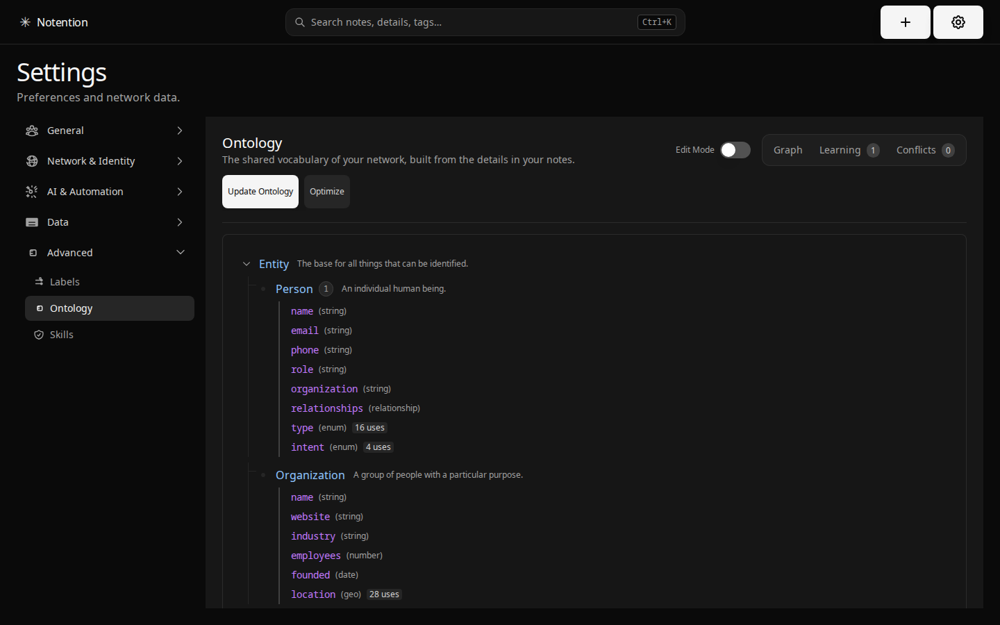

### settings / skills

Advanced skills tab, reachable by deep link.

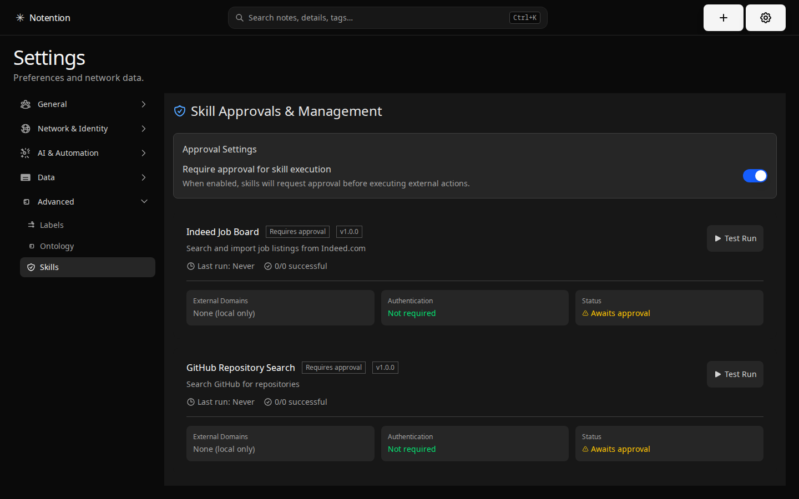
