# Screenshots

Generated by `pnpm run screenshots`. These images demonstrate what the system can do; they are not test baselines.

28 images.

### actions / board

No description available

### chat / thread

No description available

### editor / add-detail

No description available

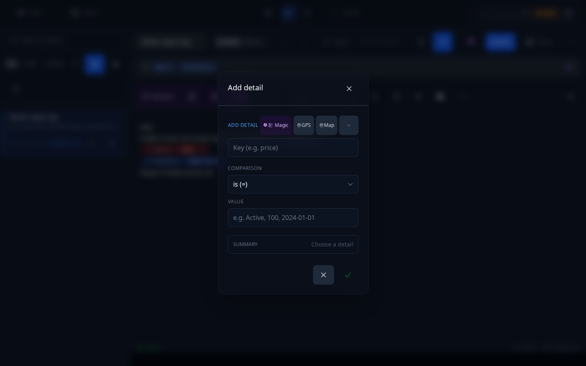

### editor / extraction-review

No description available

### editor / property-chips

No description available

### editor / property-inspector

No description available

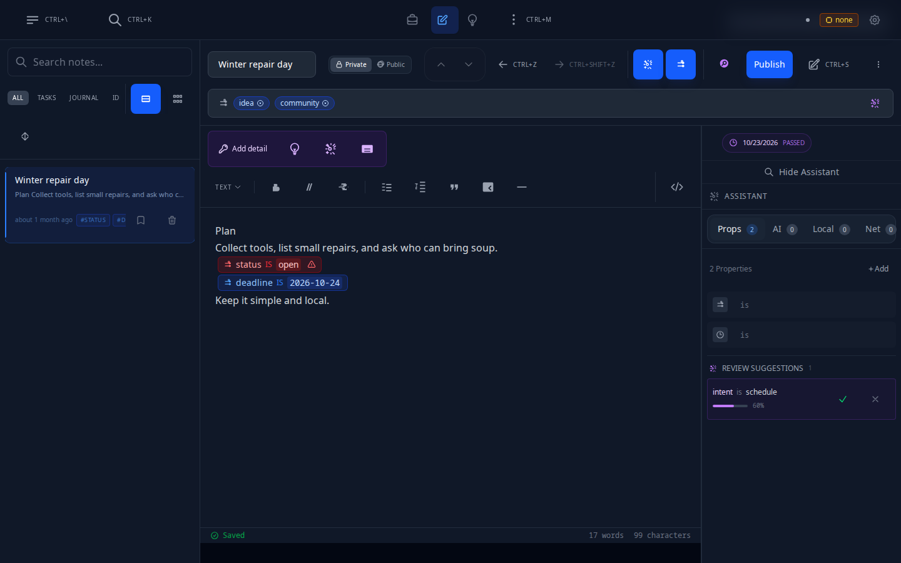

### editor / publish-panel

No description available

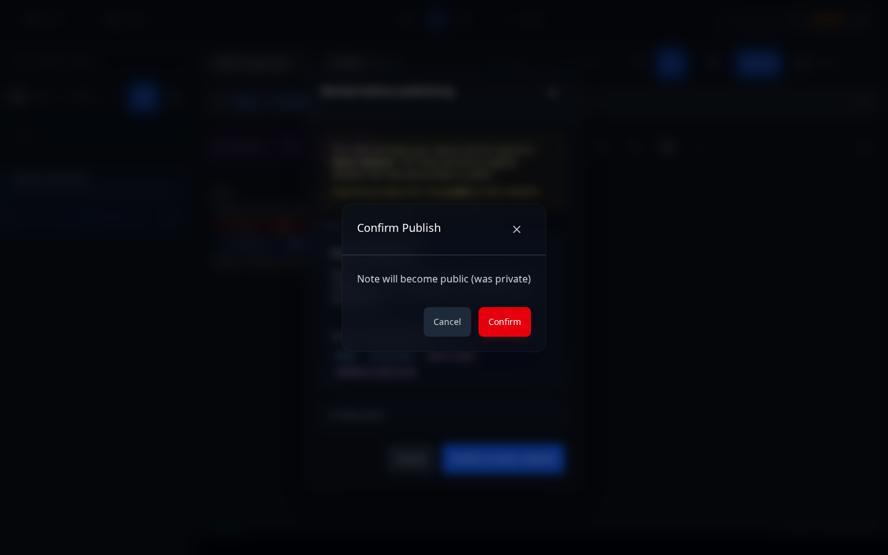

### editor / template-selector

No description available

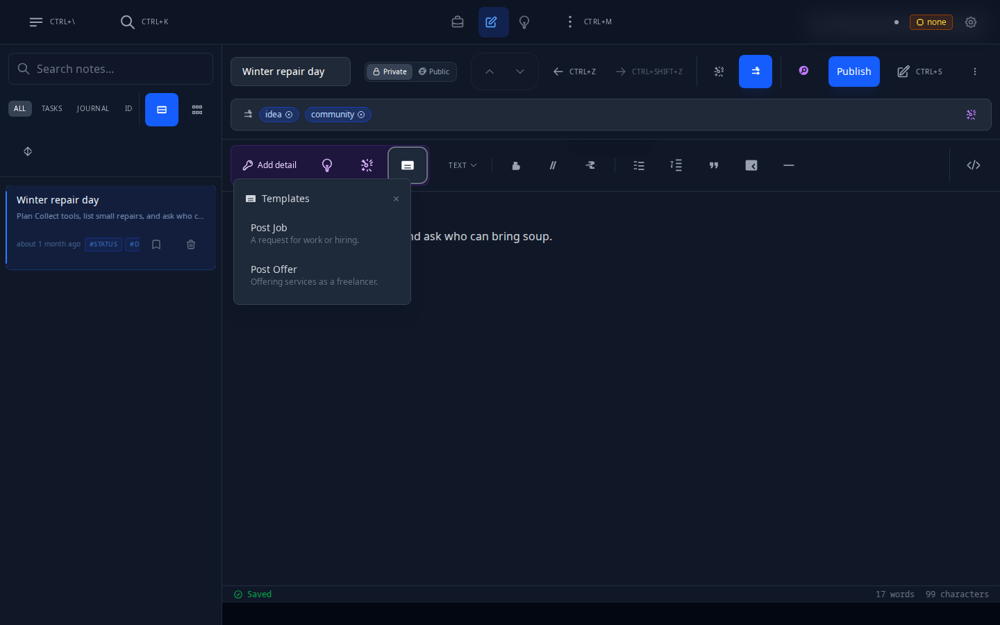

### inbox / empty

No description available

### map / pins

No description available

### matching / explanation

No description available

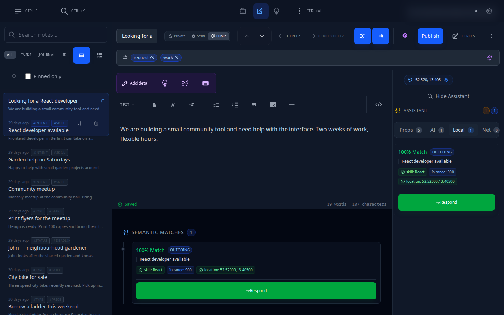

### matching / results

No description available

### mobile / notes

No description available

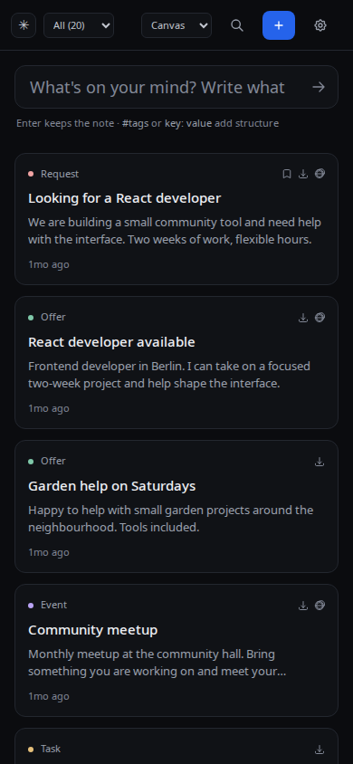

### modals / command-palette

No description available

### modals / help

No description available

### network / connect-identity

No description available

### network / feed

No description available

### notes / list-selected

No description available

### notes / trash

No description available

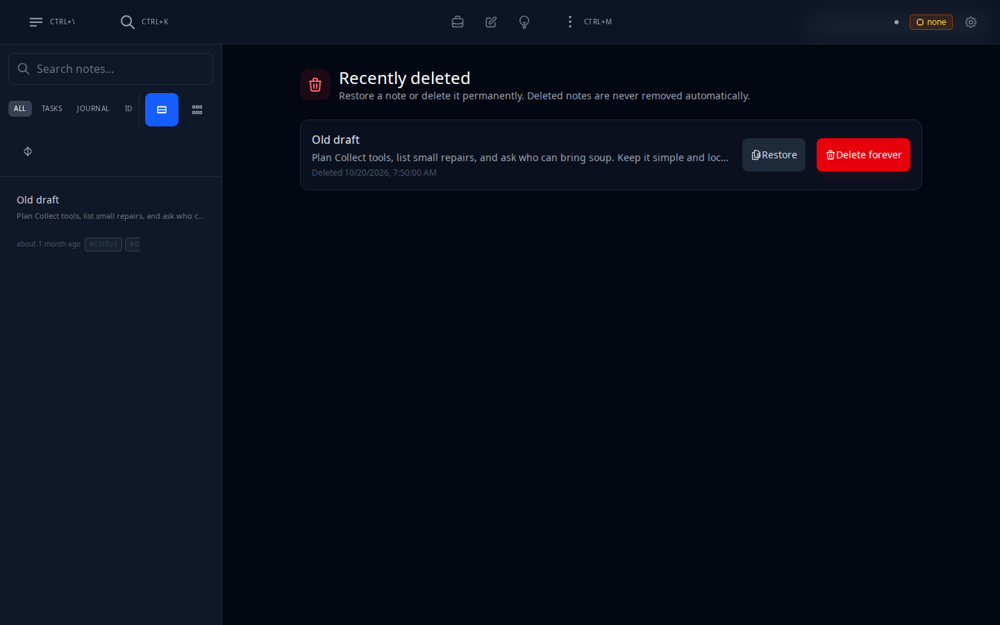

### ontology / graph

No description available

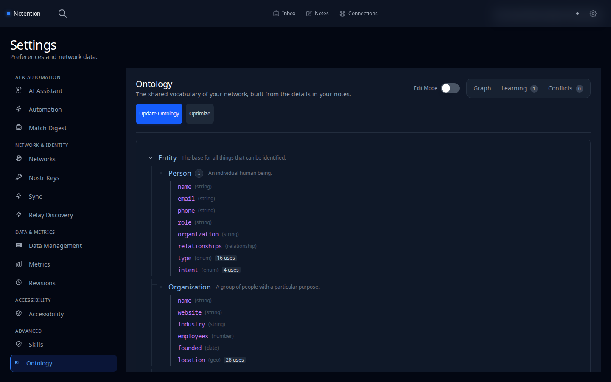

### settings / networks

No description available

### suggestions / empty-state

No description available

### suggestions / job-request-missing-budget

No description available

### suggestions / meetup-request-missing-location

No description available

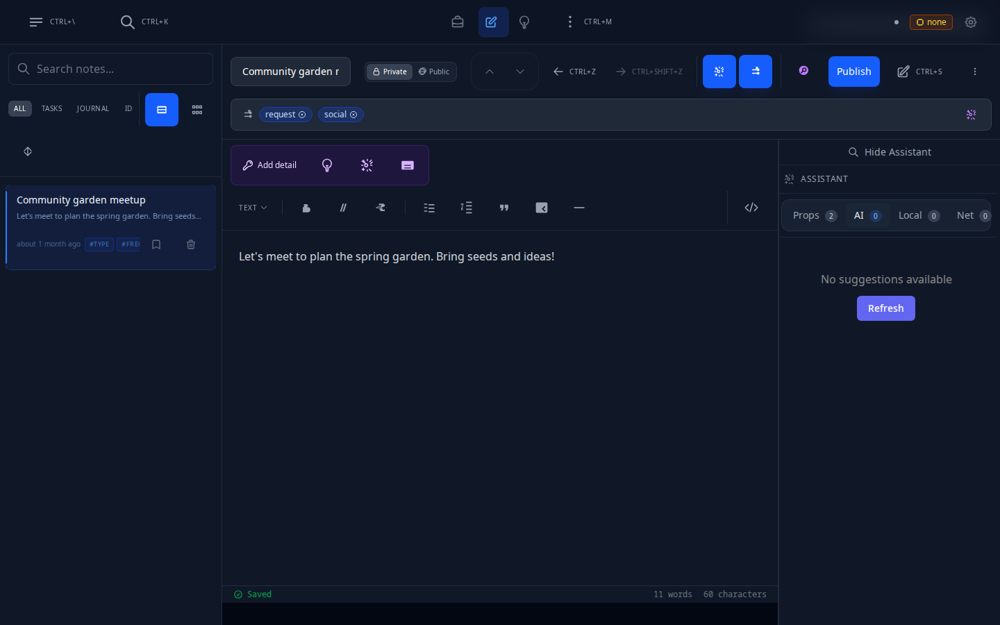

### suggestions / multiple-suggestions

No description available

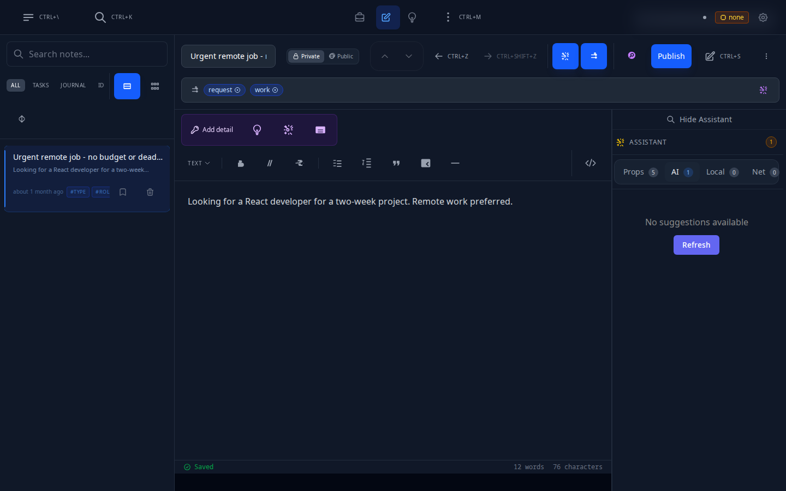

### suggestions / skill-matched-fulfillment-hint

No description available

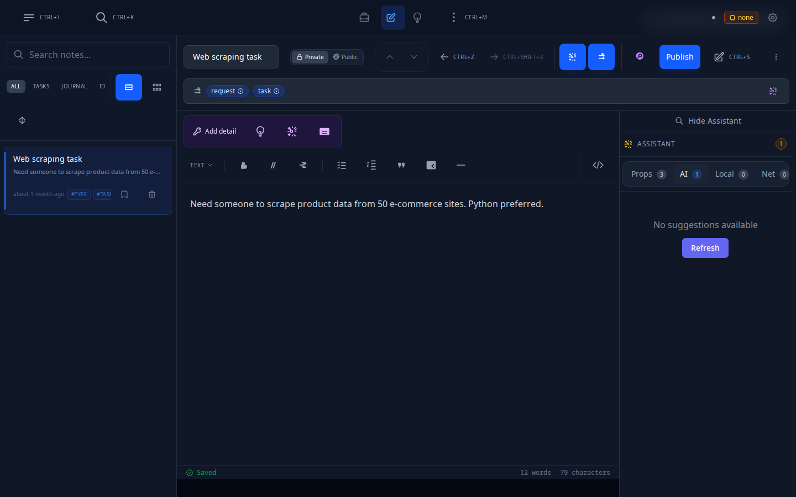

### suggestions / urgent-request-missing-deadline

No description available

### timeline / month

No description available

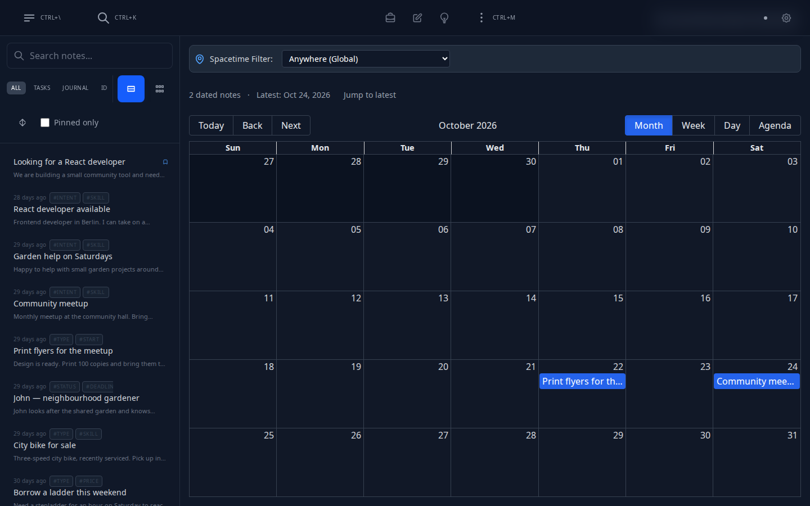
