# Screenshots

Generated by `pnpm screenshots` (all) or `pnpm screenshot <group>` (one area). Set `SCREENSHOT_WORKERS` to change parallelism (defaults to the machine CPU count, capped at 8). These images demonstrate what the system can do; they are not test baselines.

38 images.

### actions / board

Tasks grouped into status columns, with capture in reach.

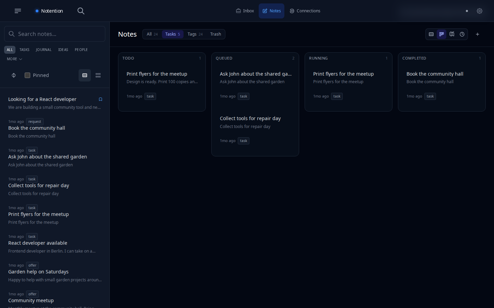

### chat / thread

An encrypted conversation over the local relay, with the encryption notice.

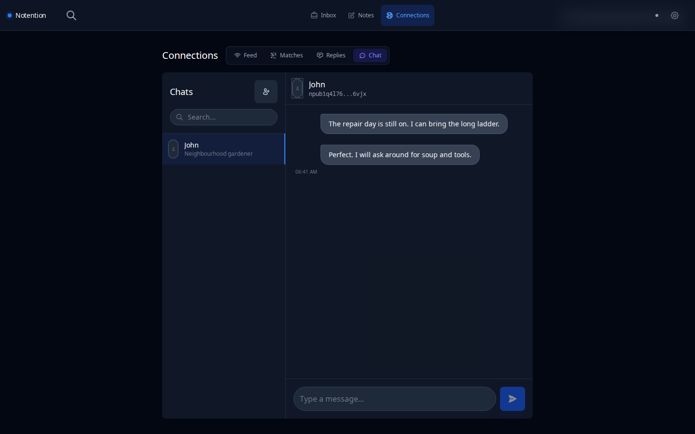

### editor / add-detail

Type-aware popup for adding a structured detail.

### editor / extraction-review

Deterministic suggestions with accept/reject and a source label.

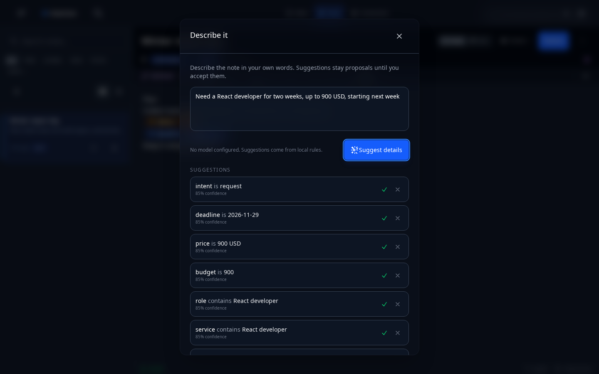

### editor / property-chips

Prose with structured detail chips and no visible bracket syntax.

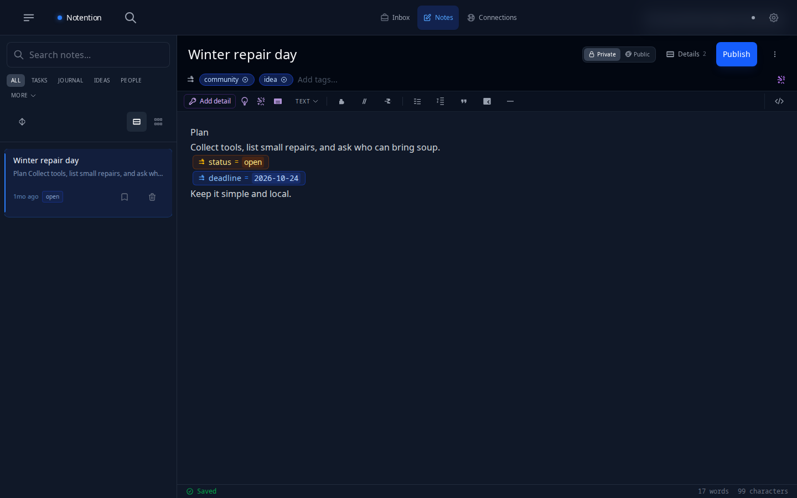

### editor / property-inspector

The details drawer with typed widgets, ontology hints, and validation.

### editor / publish-panel

Publish disclosure with a human summary and a collapsed raw event.

### editor / template-selector

Save a note as a reusable template with a name.

### inbox / empty

First run with an empty notebook and a sample-workspace affordance.

### inbox / populated

Capture, a local match, and recent notes.

### map / pins

Notes with locations plotted on the map.

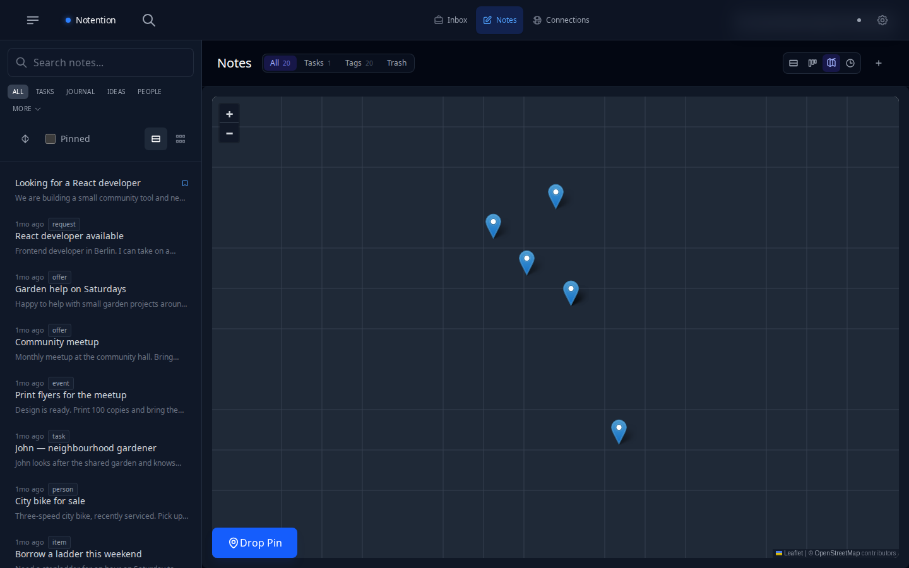

### matching / results

Requests matched against local offers in the Connections view.

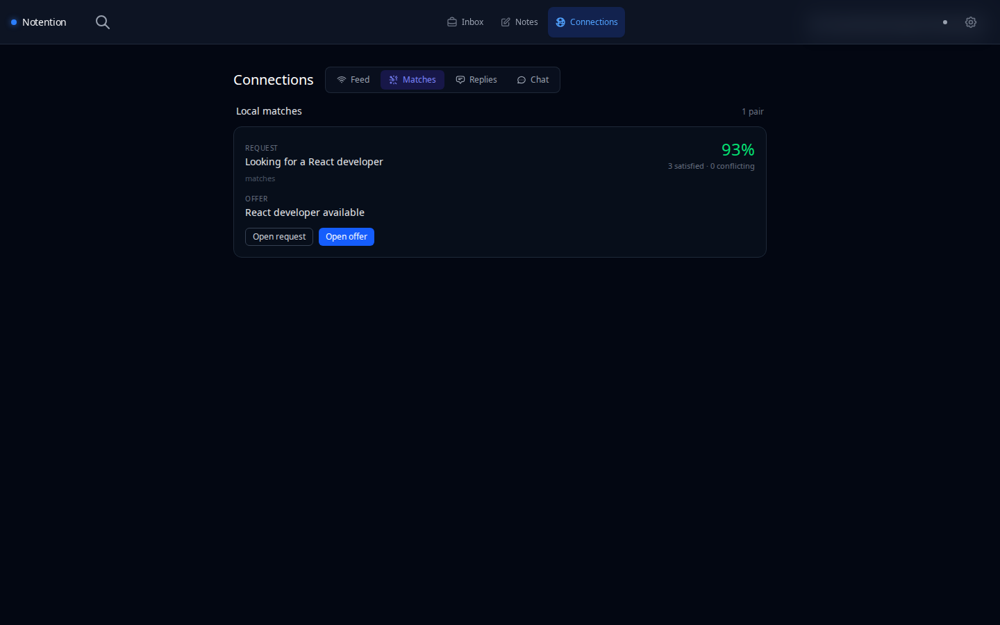

### mobile / notes

The mobile note list with bottom navigation.

### modals / command-palette

Command palette with a query matching notes and commands.

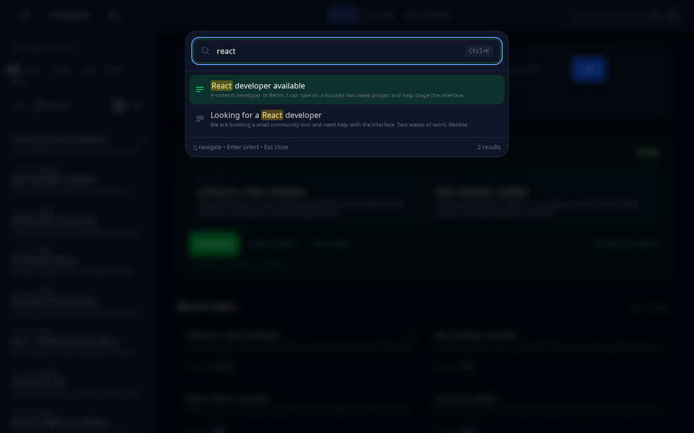

### modals / help

Keyboard shortcut reference grouped by task.

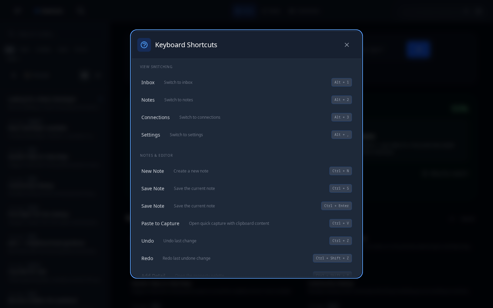

### network / connect-identity

Network view before an identity exists, prompting setup.

### network / feed

Public feed with signed notes from a local relay, including structured details.

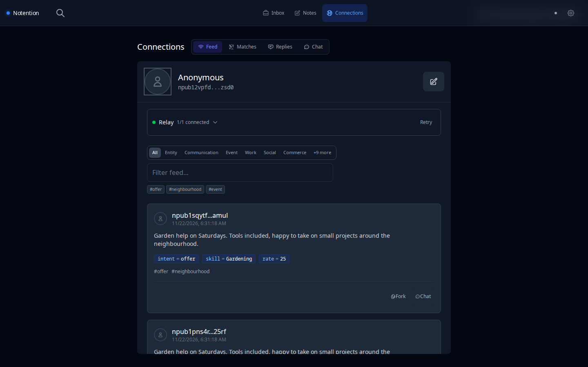

### next-steps / applied

Applied history opens on demand, with fit count and undo.

### next-steps / drawer-open

Next steps drawer opens showing all steps with sections for active, applied history, and matches.

### next-steps / empty

A note with no triggers stays quiet: no empty next-steps chrome.

### next-steps / mobile

Next steps strip on mobile viewport shows single card with touch-friendly targets.

### next-steps / multiple

Note with multiple triggers shows multiple next step cards (Add budget, Add deadline, Fulfillment hint).

### next-steps / single

Job request note triggers single "Add budget" next step via deterministic rules.

### next-steps / stale

A suggestion from before an edit stays visible with a Refresh action, instead of disappearing.

### next-steps / zero-match

The drawer keeps suggestions and history separate from the note, even with no matches.

### notes / grid

Grid mode with pinned and private notes visible at a glance.

### notes / list-selected

List mode with a note open in the editor.

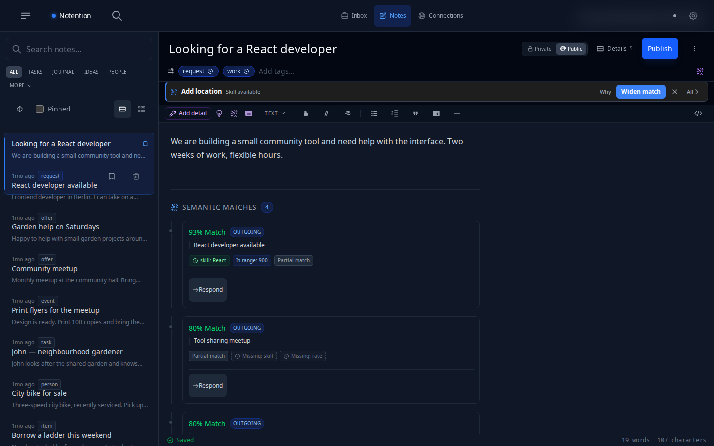

### notes / trash

Trash with restore and permanent-delete affordances.

### ontology / graph

Ontology tree with domains, attributes, and usage counts.

### settings / networks

Provider status and relay management.

### settings / skills

Skill approvals, capability scopes, and execution history.

### suggestions / empty-state

A note with no triggers stays quiet: no empty next-steps chrome.

### suggestions / job-request-missing-budget

Job request note triggers "Add budget" next step via deterministic rules.

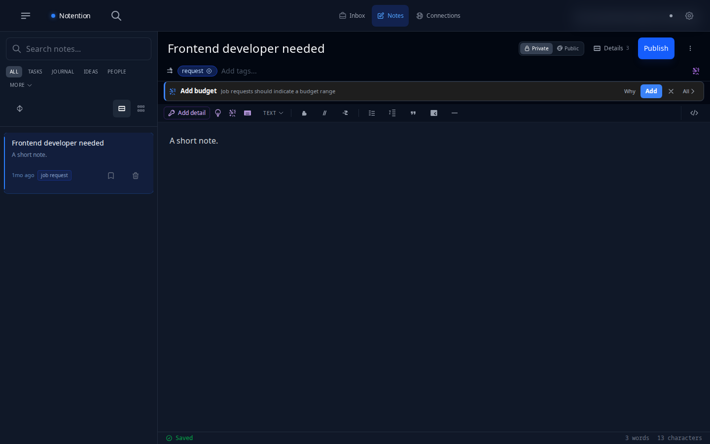

### suggestions / multiple-suggestions

Note with multiple triggers shows multiple next step cards.

### suggestions / offer-missing-contact

Offer note triggers "Add contact" next step via deterministic rules.

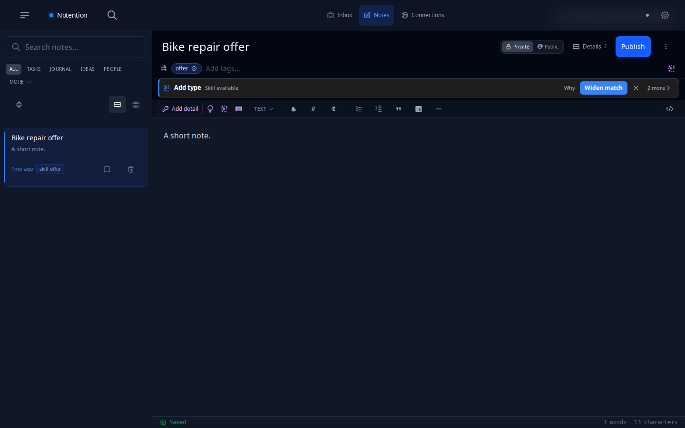

### suggestions / recurring-request-missing-schedule

Recurring request note triggers "Add schedule" next step via deterministic rules.

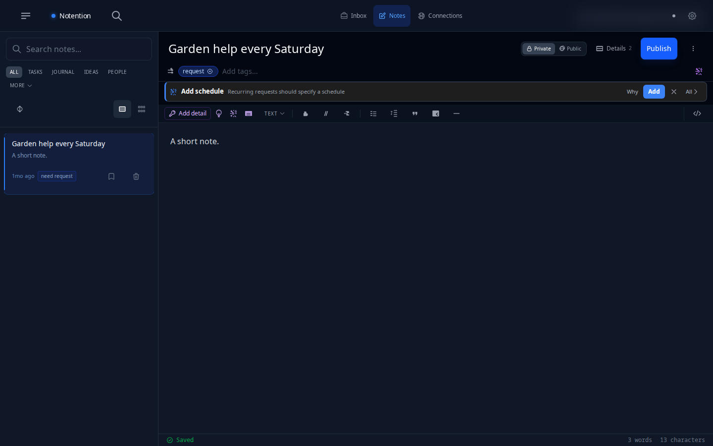

### suggestions / urgent-request-missing-deadline

Urgent request note triggers "Add deadline" next step via deterministic rules.

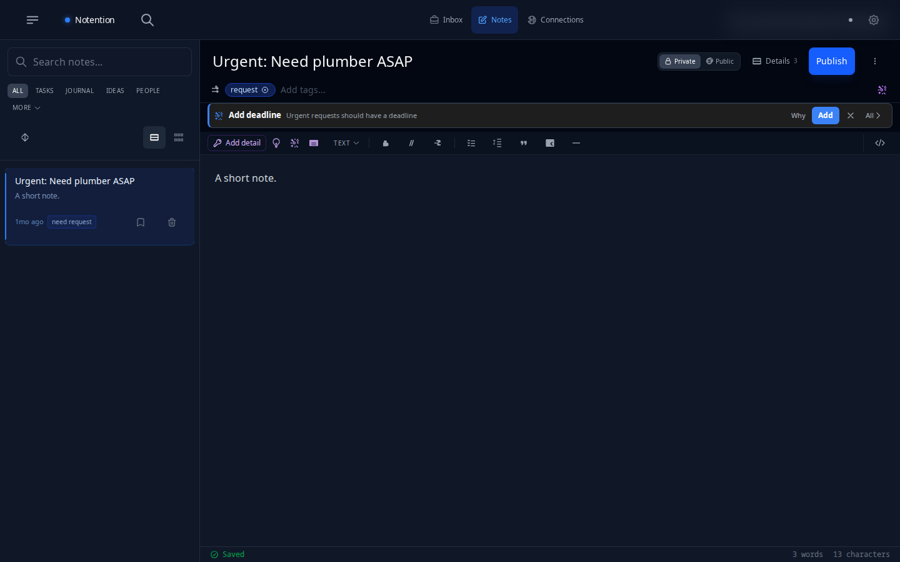

### timeline / month

Dated notes on a month calendar, filterable by location.

