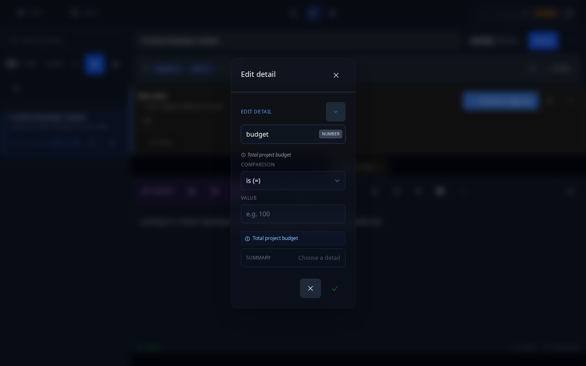
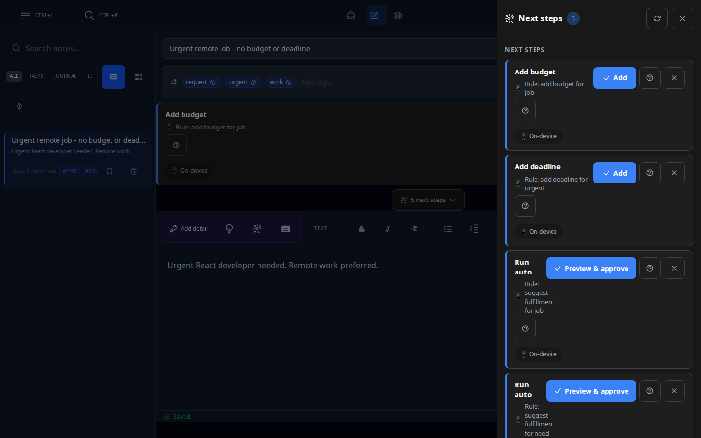
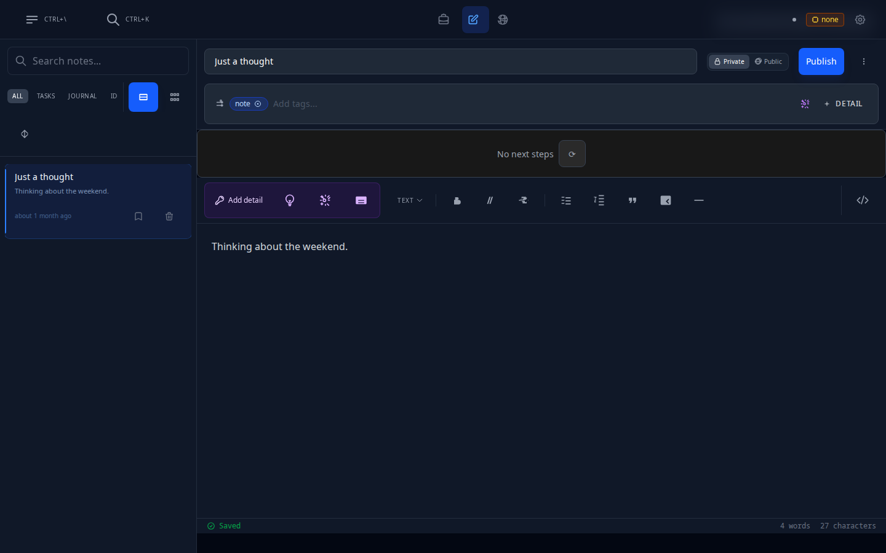
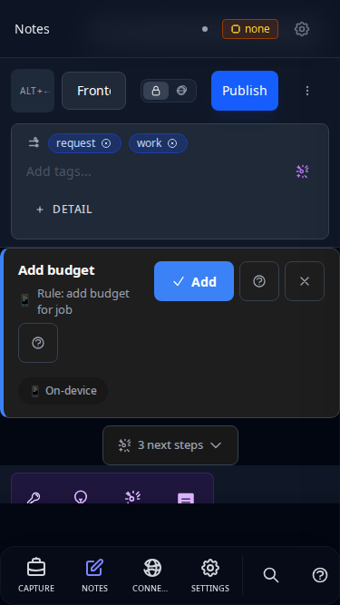
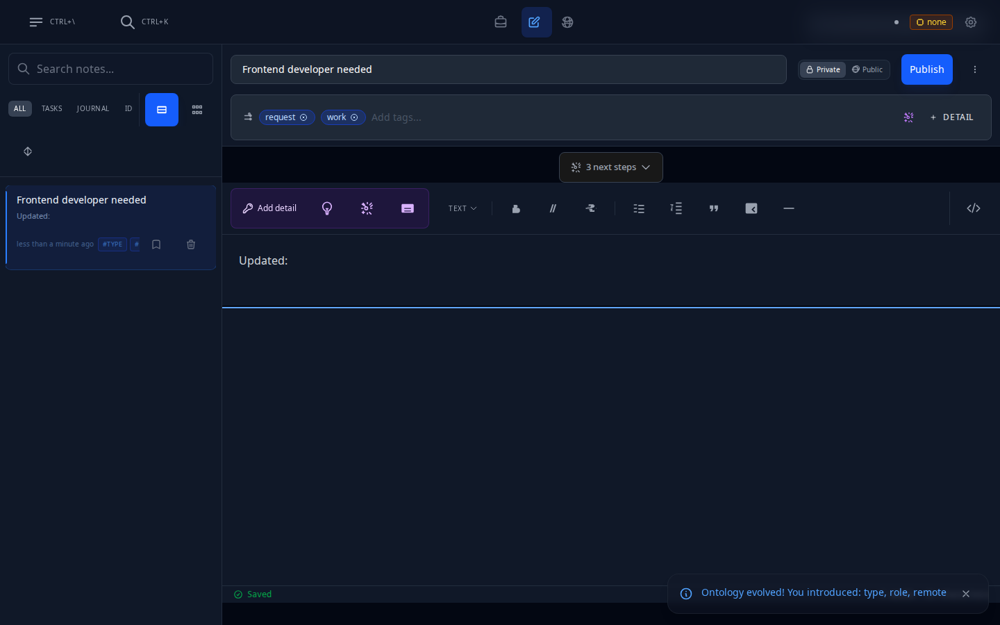
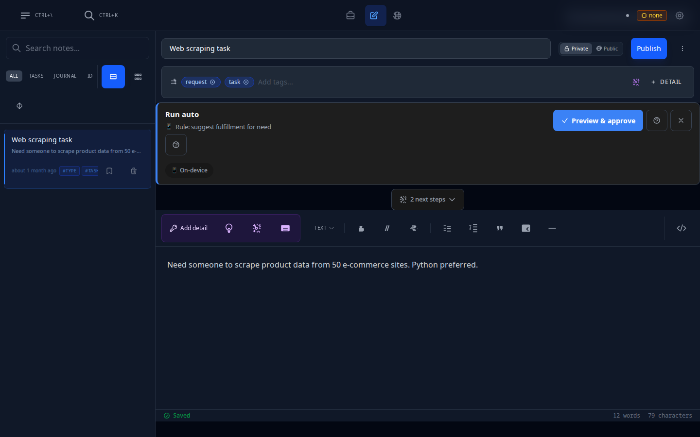

# Screenshots

Generated by `pnpm run screenshots`. These images demonstrate what the system can do; they are not test baselines.

14 images.

### next-steps / applied

After applying a next step, it shows in applied history with fit count and undo button.

### next-steps / drawer-open

Next steps drawer opens showing all steps with sections for active, applied history, and matches.

### next-steps / empty

Simple note with no matching rules shows empty next steps state with refresh button.

### next-steps / mobile

Next steps strip on mobile viewport shows single card with touch-friendly targets.

### next-steps / multiple

Note with multiple triggers shows multiple next step cards (Add budget, Add deadline, Fulfillment hint).

### next-steps / single

Job request note triggers single "Add budget" next step via deterministic rules.

### next-steps / stale

After editing a note, prior next steps become stale (showing refresh action) and new generation starts.

### next-steps / zero-match

Skill-matched note shows fulfillment next step but zero local/network matches.

### suggestions / empty-state

Simple note with no matching rules shows empty suggestions state with refresh button.

### suggestions / job-request-missing-budget

Job request note triggers "Add budget" suggestion via deterministic rules.

### suggestions / meetup-request-missing-location

Meetup request note triggers "Add location" suggestion via deterministic rules.

### suggestions / multiple-suggestions

Note with multiple triggers shows multiple suggestion cards (add budget, add deadline, fulfillment hint).

### suggestions / skill-matched-fulfillment-hint

Note matching skill patterns shows fulfillment hint suggestion.

### suggestions / urgent-request-missing-deadline

Urgent request note triggers "Add deadline" suggestion via deterministic rules.

